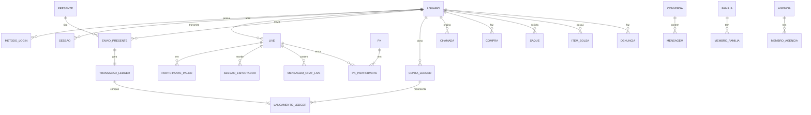

# DATABASE.md — Modelo de dados vivo

> **Para que serve.** O banco de dados ainda não existe (ADR 0002). Este documento é a **memória de tudo que o produto precisa guardar**. Cada tela, endpoint, evento e fixture do mock-server que guarda ou lê dados precisa estar refletido aqui. Na Fase 11, o banco escolhido pelo usuário é gerado a partir deste documento (`/preparar-banco`).
>
> **Regras de manutenção (obrigatórias para o Claude):**
> 1. Criou ou mudou um modelo no app (`domain/`), um DTO, um endpoint, um evento ou uma fixture do mock-server? Atualize a entidade aqui **na mesma tarefa**.
> 2. Cada entidade tem **Status**: `proposta` (só no papel), `em uso no mock` (o mock-server já guarda), `validada` (telas que a usam estão prontas).
> 3. Cada entidade lista **Usada por** (IDs da especificação e endpoints). Campo sem uso por nenhuma tela deve ser questionado.
> 4. Toda mudança entra no **Histórico** no fim do arquivo (data, o que mudou, por quê).
> 5. Dados pessoais/sensíveis marcados com 🔒 (ver RN-82). Dinheiro sempre inteiro.
> 6. Este modelo é **lógico e independente de banco**. Notas específicas de relacional estão em "Notas para o banco".
> 7. Dúvida sobre dado (o que guardar, por quanto tempo, quem pode ver) → `docs/QUESTOES-ABERTAS.md`, não invente.

## Convenções
| Item | Convenção |
| --- | --- |
| Identificadores | `id` texto ordenável por tempo (ULID ou UUIDv7). Usuário também tem `numero_publico` (inteiro curto, exibido no perfil e usado na busca). |
| Datas | `*_em` em UTC (ISO-8601). |
| Dinheiro | Moedas e diamantes: inteiro. Reais: inteiro em centavos (`*_centavos`). |
| Exclusão | Exclusão lógica (`excluido_em`) para entidades de usuário; anonimização após carência (RN-80). Ledger e auditoria nunca são apagados. |
| Auditoria | Entidades editáveis pelo painel guardam `criado_em`, `atualizado_em`, `atualizado_por`. |
| Enums | Valores em texto minúsculo com `_` (ex.: `em_analise`). |
| Tenant | Um banco por cliente (ADR 0001), então não há `tenant_id` nas tabelas. |

## Mapa de domínios
`Conta` · `Social` · `Live` · `Presentes` · `PK` · `Chamadas` · `Mensagens` · `Feed` · `Economia (ledger)` · `Pagamentos e saques` · `VIP e itens` · `Assinaturas de criador` · `Famílias` · `Agências` · `Progressão e rankings` · `Notificações` · `Moderação e segurança` · `Suporte` · `Configuração` · `Painel e auditoria`

---

## Conta

### Usuario — status: em uso no mock (parcial: id, situacao_conta [ativa, suspensa, banida], criado_em; perfil na 1c)
Usada por: ENT*, PER*, quase tudo · `/v1/me`, `/v1/users/*`
| Campo | Tipo | Regras |
| --- | --- | --- |
| id | id | |
| numero_publico | inteiro | único, sequencial curto |
| username | texto | único, RN-05, minúsculo |
| username_alterado_em | data | RN-05 |
| nome_exibicao | texto | RN-05 |
| bio | texto | ≤ 200, filtrado |
| genero | enum? | opcional |
| data_nascimento 🔒 | data | imutável (RN-01) |
| pais | texto (ISO) | |
| situacao_idade | enum | `nao_verificada`, `pendente`, `verificada`, `reprovada`, `menor_bloqueado` |
| situacao_conta | enum | `ativa`, `suspensa`, `banida`, `congelada`, `exclusao_agendada`, `excluida` |
| nivel | inteiro | derivado de XP (cache) |
| xp_total | inteiro | |
| vip_nivel | enum? | cache de VipStatus (`bronze`…`desafiante`) |
| verificado_selo | booleano | PER08 |
| foto_principal_id | id → Midia | |
| contagem_seguidores / contagem_seguindo | inteiro | contadores desnormalizados |
| privacidade | objeto | ocultar online, localização, visitas, diamantes, moedas enviadas, seguidores (VIP07, CFG03) |
| preferencias | objeto | tema, notificações, conteúdo sensível, não perturbe |
| interesses | lista de texto | ENT12 |
| idioma | enum | `pt-BR`, `en` (RN-07, CFG14) |
| faixa_etaria_loja | texto? | sinal de idade da loja (Play Age Signals) no cadastro (RN-01) |
| faixa_etaria_consultada_em | data? | |
| tutoriais_vistos | lista de texto | NAV04 |
| criado_em / atualizado_em / excluido_em | data | |

**Derivado (não é coluna):** `precisa_perfil` = `nome_exibicao`, `username` ou `data_nascimento` ainda vazios (JSON `needsProfile`). No mock é um booleano guardado (`true` ao criar, `false` nas contas semeadas) até a 1c. Ids no mock: `u_<uuid>` nas contas criadas por login e `u-ana` etc. nas semeadas.

### MetodoLogin — em uso no mock
Usada por: ENT03–ENT07, ENT15 · no mock: usuario_id, tipo, identificador, senha_hash (scrypt), verificado_em; sem `id`/`criado_em` ainda. `google` no mock: identificador = hash do e-mail (no real é o `sub`). Método de e-mail só existe depois de confirmado; antes disso, ver CadastroPendente.
| Campo | Tipo | Regras |
| --- | --- | --- |
| id, usuario_id | id | |
| tipo | enum | `telefone`, `email`, `google` |
| identificador 🔒 | texto | telefone E.164 / e-mail normalizado / sub do Google; único por tipo |
| senha_hash 🔒 | texto? | só `email`; hash forte |
| verificado_em | data? | |
| criado_em | data | |

### CodigoVerificacao — em uso no mock (efêmero; cache com expiração)
Usada por: ENT04, ENT05, ENT07 · campos: destino 🔒, finalidade (`login`, `cadastro`, `recuperar_senha`, `vincular`; JSON `login`/`signup`/`reset`; `vincular` ainda não usado; por e-mail só `cadastro` e `recuperar_senha`), codigo_hash 🔒, tentativas, expira_em (60 s, RN-02), usado_em, senha_hash_cadastro 🔒? (hash da senha de **quem pediu** este código, só `cadastro` por e-mail: a confirmação exige a mesma senha, contra sequestro de cadastro; senha errada consome o código). Chave única (finalidade, destino): código novo substitui o anterior; apagado na 5ª tentativa errada, ao expirar ou ao ser usado. Contador de envios: horários por destino (máx. 5/h, reenvio após 60 s, RN-02) e por IP (60/h). `canal` (sms/whatsapp/email) não é guardado. No banco real: guardar como HMAC com chave do servidor (M-037).

### CadastroPendente — em uso no mock (efêmero)
Usada por: ENT05 · email 🔒 (normalizado), senha_hash 🔒. Criado por `POST /auth/email/signup` quando o e-mail não tem conta confirmada; removido ao confirmar o código. Não bloqueia o e-mail (novo pedido substitui). Quem confirma precisa da senha do código (ver CodigoVerificacao).

### AvisoConta — em uso no mock (vira Notificacao na Fase 8)
Usada por: ENT05, ENT19, SEGURANCA.md (alerta de novo aparelho) · usuario_id?, destino 🔒?, tipo (`ja_tem_conta`: pedido de cadastro para e-mail que já tem conta; `novo_aparelho`: login em aparelho diferente do das sessões anteriores; `sessao_revogada`: reuso de refresh detectado), criado_em. No mock só em memória (`notices`); envio real (e-mail/push) na Fase 8.

### Sessao — em uso no mock (ADR 0012)
Usada por: ENT19, CFG02 · campos: id (`sid` no access token), usuario_id, dispositivo_id, refresh_token_hash 🔒, refresh_anterior_hash 🔒 + trocado_em (tolerância de 10 s), criada_em, ultimo_uso_em, expira_absoluta_em (180 dias, Q-54), revogada_em, motivo_revogacao (`logout`, `outro_aparelho`, `mesmo_aparelho`, `senha_trocada`, `reuso_refresh`, `expirada`, `conta_bloqueada`, `admin`), carencia_usada (o refresh anterior vale **uma vez** dentro dos 10 s; não reabre a janela), ip_aproximado 🔒, user_agent. Ociosidade: expira com 30 dias sem uso (Q-50, derivado de `ultimo_uso_em`). **Regra:** no máximo uma sessão não revogada por usuário (RN-06). No mock não são guardados `ip_aproximado` nem `user_agent`. Motivo → erro HTTP: `outro_aparelho` → `sessao_substituida`; `expirada` → `sessao_expirada`; os demais → `sessao_revogada`. Motivo → evento de tempo real: ver EVENTOS-TEMPO-REAL.md (Detalhes).

### Dispositivo — em uso no mock
Usada por: ENT01 (`POST /devices`), ENT19, TRV05, SEG05, RN-06 · campos: id (gerado pelo servidor), segredo_hash 🔒 (ADR 0012), usuario_id?, plataforma (`android`, `ios`, `web` só teste), modelo?, versao_app, idioma, token_push 🔒 (TRV05), impressao_antifraude 🔒 (SEG05), registrado_em, visto_em. No mock: id, segredo_hash 🔒, usuario_id (último usuário que entrou no aparelho), plataforma, modelo, versao_app, idioma, registrado_em, visto_em. Atualizar exige id + segredo certos; senão cria outro aparelho. Limite: 60 criações por IP por hora (mock).

### VerificacaoIdade — proposta
Usada por: ENT09, TRA01, POR02, SEG07 · campos: id, usuario_id, metodo (`estimativa_facial`, `documento`), provedor (conector configurado em IntegracaoProvedor), referencia_provedor, resultado (`pendente`, `aprovado`, `reprovado`, `expirado`), idade_estimada?, motivo?, criado_em, concluido_em. Não guardar imagens do rosto/documento além do exigido pelo provedor e pelo jurídico.

### AceiteTermos — em uso no mock
Usada por: ENT16, TRA01 · campos: id, usuario_id, documento (`termos`, `privacidade`, `diretrizes`, `regras_transmissao`, `regras_saque`), versao, aceito_em, dispositivo_id, ip_aproximado 🔒. JSON ↔ banco: `terms`↔`termos`, `privacy`↔`privacidade`, `guidelines`↔`diretrizes`. No mock: sem `id`; `ip` guardado completo (no banco real gravar só o aproximado); só `termos` e `privacidade` bloqueiam o uso (`diretrizes` é aceitável, não obrigatória: Q-55); (usuario_id, documento, versao) deve ser único (o mock ainda duplica se aceitar de novo). Contas semeadas: termos e privacidade v1 aceitos, sem dispositivo/ip.

### Controles efêmeros de autenticação — em uso no mock (cache, não vão para o banco relacional)
Usada por: SEG06, RN-02, ENT04–ENT07
- **TentativaFalha** (força bruta): chave → { contagem, bloqueado_ate }. Chaves: `acct:<e-mail>|dev:<aparelho>` (login por e-mail), `dest:<destino>|dev:<aparelho>` (confirmação de código), `dest:<e-mail>|ip:<ip>` (recuperar senha) e `ip:<ip>` (limite alto, 50, por causa de CGNAT). 5 falhas por chave de conta/destino; bloqueio de 60 s dobrando a cada falha extra. Sucesso zera só a chave de conta/destino. Outro aparelho errando não tranca o dono.
- **LimiteIp:** `send|<ip>` (envio de código, 60/h) e `device|<ip>` (registro de aparelho, 60/h): lista de horários.
- **TokenAntibotUsado:** conjunto de `rota|token` já gastos (uso único por rota). No mock, token válido = `fake-ok-<8 a 64 caracteres [A-Za-z0-9_-]>`.

### Midia — proposta
Usada por: PER02, MSG02, MSG04, FEED02, TRA02 · campos: id, dono_id, tipo (`imagem`, `video`, `audio`), url_armazenamento, largura, altura, duracao_s, tamanho_bytes, situacao_moderacao (`pendente`, `aprovada`, `sensivel`, `reprovada`), criado_em.

### DadosRecebimento 🔒 — proposta
Usada por: POR02, POR03, ADM08 · campos: id, usuario_id, nome_completo 🔒, cpf 🔒 (criptografado; exibir mascarado), tipo_chave_pix (só `cpf`, RN-82), chave_pix 🔒, titularidade_verificada_em?, atualizado_em.

---

## Social

### Seguir — proposta
Usada por: ASS05, PER03, PER04, DES09 · chave (seguidor_id, seguido_id), criado_em. Índices por seguido e por seguidor.

### Bloqueio — proposta
Usada por: MSG08, PER03, CFG05 · chave (bloqueador_id, bloqueado_id), criado_em.

### VisitaPerfil — proposta
Usada por: PER05 · campos: visitante_id, visitado_id, visitado_em (agregar por dia).

### HistoricoBusca — proposta (pode ficar só no dispositivo)
Usada por: DES05.

---

## Live

### Live — proposta
Usada por: DES*, ASS*, TRA*, PK*, ADM04 · `/v1/lives/*`
| Campo | Tipo | Regras |
| --- | --- | --- |
| id | id | |
| host_id | id → Usuario | |
| tipo | enum | `publica`, `privada_paga`, `grupo` |
| privada_motivo | enum? | `host`, `ausencia_detectada` (RN-48) |
| titulo | texto | filtrado |
| capa_midia_id | id? | |
| categoria | texto | |
| situacao | enum | `preparando`, `ao_vivo`, `pausada`, `encerrada` |
| motivo_encerramento | enum? | `host`, `queda`, `moderacao`, `conteudo_detectado`, `admin` |
| canal_video | texto | identificador no provedor de vídeo |
| presente_minuto_id | id? → Presente | só `privada_paga`; vem do MenuCobranca do host (RN-53) |
| vagas_palco | inteiro | RN-47 |
| espectadores_agora / pico_espectadores / espectadores_unicos | inteiro | contadores |
| diamantes_total / moedas_total / curtidas_total | inteiro | contadores |
| pais | texto | para descoberta |
| iniciada_em / encerrada_em | data | |

### ParticipantePalco — proposta
Usada por: TRA07, TRA08, ASS09 · campos: id, live_id, usuario_id, papel (`host`, `convidado`, `palestrante`), posicao, microfone_ligado, camera_ligada, entrou_em, saiu_em.

### PedidoPalco — proposta
Usada por: ASS09, TRA07 · campos: id, live_id, usuario_id, origem (`pedido`, `convite`), situacao (`pendente`, `aceito`, `recusado`, `expirado`, `cancelado`), criado_em, respondido_em.

### SessaoEspectador — proposta
Usada por: ASS06, EST04, TRA14 · campos: id, live_id, usuario_id, modo (`normal`, `sussurro`, `incognito`), entrou_em, saiu_em, moedas_gastas.

### MensagemChatLive — proposta (alto volume; retenção curta, padrão 30 dias configurável)
Usada por: ASS02, ASS03, ASS11 · campos: id, live_id, autor_id, texto, tipo (`texto`, `sistema`, `gorjeta`, `destaque`), sussurro, mencoes, criada_em, removida_em.

### ModeradorLive — proposta
Usada por: TRA06, CFG06 · campos: host_id, moderador_id, escopo (`permanente`, `live`), live_id?, criado_em.

### SancaoLive — proposta
Usada por: TRA06, ASS16 · campos: id, live_id, usuario_id, tipo (`silenciado`, `expulso`), aplicada_por, ate_em?, criada_em, desfeita_em.

### DeteccaoConteudo — proposta
Usada por: TRA13, SEG02, ADM21 · campos: id, live_id, host_id, tipo (`rosto_ausente`, `nudez`, `violencia`, `outro`), confianca, acao (`aviso`, `virou_privada`, `encerrada`), evidencia_midia_id?, denuncia_id?, criado_em. Nunca há ação que torne conteúdo proibido em privado (RN-48).

### MetaLive — proposta
Usada por: ASS15 · campos: id, live_id, titulo, valor_inicial, valor_alvo, valor_atual, termina_em, atingida_em.

### RoletaPedidos / OpcaoRoleta / GiroRoleta — proposta
Usada por: PRE08 · Roleta(id, host_id, presente_exigido_id, ativa); Opcao(id, roleta_id, texto, peso); Giro(id, roleta_id, live_id, usuario_id, envio_presente_id, opcao_sorteada_id, criado_em).

### ItemMenuGorjeta — proposta
Usada por: PRE09 · campos: id, host_id, texto, preco_moedas, ativo, ordem.

### StickerMeta — proposta
Usada por: PRE07 · campos: id, live_id, sticker_id, presente_id, meta_quantidade, quantidade_atual.

---

## Presentes

### Presente (catálogo) — proposta
Usada por: PRE*, ADM06 · campos: id, nome (por idioma: pt-BR, en), categoria_id, preco_moedas, tipo (`comum`, `grande`, `super`, `sorte`, `exclusivo`), exige_vip_nivel?, exige_nivel?, elegivel_cobranca_minuto (RN-53), midia (imagem, lottie_url, video_url), duracao_animacao_ms, ativo, ordem, posicoes (`live`, `chamada`, `conversa`, `pk`).

### CategoriaPresente — proposta · id, nome, ordem, ativa.

### EnvioPresente — proposta
Usada por: PRE01–PRE11, PK06, CHA05, MSG02 · `POST /v1/gifts/send`
| Campo | Tipo | Regras |
| --- | --- | --- |
| id | id | |
| chave_idempotencia | texto | única por remetente |
| remetente_id / destinatario_id | id | |
| presente_id | id | |
| quantidade | inteiro | ≥ 1 |
| contexto | enum | `live`, `pk`, `chamada`, `conversa`, `roleta`, `gorjeta`, `cobranca_minuto` |
| contexto_id | id | live, pk, chamada ou conversa |
| moedas_total | inteiro | preço do servidor × quantidade |
| moedas_pagas / moedas_gratis | inteiro | proporção consumida (RN-32) |
| diamantes_normais / diamantes_bonus | inteiro | RN-23, RN-30 |
| sussurro | booleano | RN-72 |
| combo_id | id? | agrupar combo |
| transacao_ledger_id | id | |
| criado_em | data | |

---

## PK

### Pk — proposta
Usada por: PK* · campos: id, modo (`1x1`, `2x2`, `todos`), situacao (`convidando`, `conectando`, `em_batalha`, `castigo`, `encerrada`, `cancelada`), duracao_s, iniciada_em, termina_em, encerrada_em, vencedor_lado?, motivo_fim (`tempo`, `desistencia`, `queda`, `cancelada`).

### PkParticipante — proposta · pk_id, live_id, host_id, lado, pontos, entrou_em, saiu_em.

### ConvitePk — proposta · id, de_live_id, para_live_id?, aleatorio, situacao (`pendente`, `aceito`, `recusado`, `expirado`, `cancelado`), criado_em, expira_em.

---

## Chamadas

### ConfigChamadas — proposta
Usada por: CHA01, CHA10 · usuario_id, aceita_voz, aceita_video, so_seguidores, disponibilidade, nao_perturbe_ate.

### MenuCobranca — proposta
Usada por: PRE12, CHA01, TRA14 · usuario_id, presente_voz_id, presente_video_id, presente_live_privada_id (todos → Presente com `elegivel_cobranca_minuto`), atualizado_em.

### Chamada — proposta
Usada por: CHA* · campos: id, tipo (`voz`, `video`), modalidade (`paga`, `gratuita`), chamador_id, receptor_id, presente_minuto_id, moedas_por_minuto (cópia do preço no início), situacao (`chamando`, `conectando`, `em_andamento`, `encerrada`, `recusada`, `perdida`, `falhou`), iniciada_em, atendida_em, encerrada_em, duracao_s, moedas_cobradas, diamantes_gerados, reembolsada, motivo_fim.

### CobrancaMinuto — proposta
Usada por: CHA06, TRA14 · id, origem (`chamada`, `live_privada`), origem_id, usuario_id, minuto_numero, envio_presente_id, moedas, reembolsada, transacao_ledger_id, criado_em.

---

## Mensagens

### Conversa — proposta
Usada por: MSG* · id, tipo (`direta`, `familia`, `suporte`, `sistema`), criada_em, ultima_mensagem_em.

### ParticipanteConversa — proposta · conversa_id, usuario_id, aba (`amigos`, `outros`), fixada, silenciada, ultima_lida_id, nao_lidas, apagada_em.

### Mensagem — proposta
Usada por: MSG02–MSG12, CFG10 · id, conversa_id, autor_id, tipo (`texto`, `imagem`, `video`, `audio`, `presente`, `perfil`, `live`, `midia_paga`, `sistema`, `automatica`), texto?, midia_id?, referencia_id?, preco_moedas?, criada_em, editada_em?, removida_em?.

### DesbloqueioMidia — proposta · mensagem_id, usuario_id, moedas, transacao_ledger_id, criado_em.

### MensagemAutomatica — proposta · id, usuario_id, tipo (`boas_vindas`, `modelo`), texto, ativa.

---

## Feed

### Post — proposta · id, autor_id, texto, midias (lista de Midia), visibilidade (`todos`, `seguidores`, `assinantes`), curtidas, comentarios, criado_em, removido_em.
### ComentarioPost — proposta · id, post_id, autor_id, resposta_a_id?, texto, criado_em, removido_em.
### CurtidaPost — proposta · (post_id, usuario_id), criado_em.

---

## Economia (ledger)

### ContaLedger — proposta
Usada por: toda movimentação · campos: id, dono_tipo (`usuario`, `plataforma`, `agencia`, `sistema`), dono_id?, moeda (`moeda_paga`, `moeda_gratis`, `diamante`, `diamante_bonus`, `diamante_reservado`, `real_centavos`), tipo (`carteira`, `receita`, `reserva_saque`, `bonus`, `reembolso`, `estorno`, `comissao`), saldo_cache, versao (controle de concorrência).

### TransacaoLedger — proposta
Usada por: ECO06 e tudo que envolve valor · campos: id, tipo (`compra`, `presente`, `minuto_pago`, `desbloqueio`, `assinatura`, `item_loja`, `saque`, `reembolso`, `estorno`, `bonus`, `comissao`, `revenda`, `ajuste_admin`, `sorte`), chave_idempotencia (única), referencia_tipo, referencia_id, descricao, criado_por, criado_em.

### LancamentoLedger — proposta
campos: id, transacao_id, conta_id, valor (inteiro com sinal), criado_em. **Invariante:** soma dos lançamentos de uma transação por moeda = 0 (RN-26). Imutável.

### ConfigEconomia — proposta (versão vigente + histórico)
Usada por: ADM13, RN-21–RN-32, RN-50, RN-53, RN-58 · taxas_plataforma_bp por origem (`presente`, `chamada`, `live_privada`, `midia_paga`), conversao_diamante_centavos, saque_minimo_diamantes, saque_taxa_fixa_centavos, retencao_dias, regras_diamante_bonus (sacavel, proporcao_bp, limite_periodo), ordem_gasto (`gratis_primeiro`, `pagas_primeiro`), limites (envio, compra, saque), bonus (boas_vindas, periodico), custo_iniciar_conversa (ligado, moedas), janela_reembolso_s, confirmacao_envio_acima, super_presente_intervalo_s, vigente_desde, alterada_por.

### ConfigProgressao — proposta
Usada por: ADM20, RN-61, RN-63, RN-70 · xp_constante (50), xp_expoente (2,2), nivel_maximo (100), pesos_xp (moeda, minuto_assistido, minuto_transmitido, limites diários), recompensas_por_nivel, familia (nivel_minimo, custo_moedas, limite_membros), vigente_desde, alterada_por.

---

## Pagamentos, portal e saques

### LinkPortal — proposta
Usada por: POR01 · id, usuario_id, destino (`saque`, `dados_recebimento`, `recarga`, `assinatura`), token_hash 🔒, expira_em (curto), usado_em, ip_aproximado 🔒.

### PacoteMoedas — proposta · id, produto_loja_id, moedas, bonus_moedas, preco_centavos, etiqueta, canais (`play`, `pix`), ativo, ordem.
### Oferta — proposta · id, tipo (`primeira_compra`, `relampago`, `pacote_presentes`), pacote_id, regra_elegibilidade, comeca_em, termina_em, limite_por_usuario.
### Compra — proposta
Usada por: ECO02, ECO04, POR04, ADM17 · id, usuario_id, canal (`play`, `provedor_alternativo`, `portal_web`, `revenda`), provedor?, pacote_id, oferta_id?, valor_centavos, moedas_creditadas, situacao (`pendente`, `confirmada`, `falhou`, `estornada`), recibo_referencia 🔒 (token da Play / txid Pix, único), transacao_ledger_id, criado_em, confirmada_em.
### Saque — proposta
Usada por: POR02, ADM08 · id, usuario_id, diamantes, diamantes_bonus, valor_bruto_centavos, taxa_centavos, valor_liquido_centavos, chave_pix_mascarada, situacao (`pendente`, `em_analise`, `aprovado`, `pago`, `recusado`), motivo_recusa?, comprovante_referencia?, solicitado_em, decidido_por, decidido_em, pago_em.
### Revendedor / TransferenciaRevenda — proposta 🚩 · Revendedor(usuario_id, aprovado_por, limite_diario, ativo); Transferencia(id, revendedor_id, destinatario_id, moedas, transacao_ledger_id, criado_em).
### Indicacao — proposta 🚩 · id, indicador_id, indicado_id, codigo, valida_ate, comissao_bp.

---

## VIP e itens

### NivelVip — proposta
Usada por: VIP01, ADM09 · nivel (`bronze`, `prata`, `ouro`, `platina`, `diamante`, `desafiante`), ordem, limiar_moedas_7d, beneficios (lista de chaves), intocavel, ativo (RN-70).
### VipStatus — proposta
Usada por: VIP01, ASS12–ASS14, RN-73 · usuario_id, nivel_atual?, moedas_gastas_7d, nivel_anterior?, calculado_em, cai_em? (quando cairá se não gastar). Derivado das transações dos últimos 7 dias; pode ser recalculado a qualquer momento.
### ItemLoja — proposta · id, tipo (`efeito_entrada`, `moldura`, `balao_chat`, `destaque_perfil`, `username_especial`), nome, midia, preco_moedas, duracao_dias?, exige_vip_nivel?, ativo.
### ItemBolsa — proposta · id, usuario_id, item_id, origem (`compra`, `presente`, `recompensa`, `pacote`), equipado, expira_em, recebido_de_id?.

## Assinaturas de criador
### PlanoCriador — proposta · criador_id, ativo, preco_mensal_centavos (RN-62), desconto_primeiro_mes_bp, beneficios.
### AssinaturaCriador — proposta · id, assinante_id, criador_id, valor_centavos, provedor, referencia_provedor 🔒, situacao (`ativa`, `pendente`, `inadimplente`, `cancelada`, `expirada`), inicio_em, proxima_cobranca_em, renovacao_automatica, motivo_cancelamento?. Paga em reais pelo portal (POR05).

## Famílias
### Familia — proposta · id, nome (único), emblema_midia_id, descricao, lider_id, nivel, pontos, so_lideres_postam, limite_membros, criada_em, dissolvida_em.
### MembroFamilia — proposta · familia_id, usuario_id, cargo (`lider`, `gerente`, `membro`), silenciado_ate, entrou_em.
### PedidoFamilia — proposta · id, familia_id, usuario_id, origem (`pedido`, `convite`), situacao, criado_em.

## Agências 🚩
### Agencia — proposta · id, nome, gerente_id, comissao_bp, ativa, criada_em.
### MembroAgencia — proposta · agencia_id, streamer_id, situacao (`convidado`, `ativo`, `saiu`), entrou_em, saiu_em, pode_trocar_apos.

## Progressão e rankings
### EventoXp — proposta · id, usuario_id, origem (`moedas_gastas`, `assistiu`, `transmitiu`, `missao`), quantidade, criado_em.
### Selo / SeloUsuario — proposta · Selo(id, nome, descricao, imagem); SeloUsuario(usuario_id, selo_id, conquistado_em).
### RankingSnapshot — proposta (materializado) · tipo (`streamers`, `doadores`, `familias`), periodo (`dia`, `semana`, `mes`), pais?, inicio_periodo, posicoes (lista ordenada: id, valor, anonimo), gerado_em.
### BonusStreamer — proposta · id, usuario_id, programa, meta, progresso, diamantes_creditados, periodo.

## Notificações
### Notificacao — proposta · id, usuario_id, tipo, titulo, corpo, deep_link, lida_em, criada_em, enviada_push.
### Banner — proposta · id, posicao, imagem, deep_link, publico_alvo, comeca_em, termina_em, prioridade.

## Moderação e segurança
### Denuncia — proposta
Usada por: ASS11, CHA08, MSG08, FEED06, SEG01, ADM05 · id, denunciante_id, alvo_tipo (`live`, `usuario`, `mensagem`, `chamada`, `post`, `familia`), alvo_id, motivo_codigo, descricao, prioridade (`maxima`, `alta`, `normal`), evidencias (lista: trecho de chat, frame, mensagens), situacao (`aberta`, `em_analise`, `resolvida`, `descartada`), resolvida_por, acao_tomada, criada_em, resolvida_em.
### MotivoDenuncia — proposta · codigo, alvo_tipo, texto, prioridade, ativo.
### Sancao — proposta · id, usuario_id, tipo (`aviso`, `silenciamento`, `suspensao`, `banimento`, `congelamento_saldo`), motivo, aplicada_por, inicio_em, fim_em?, apelacao_situacao?, revogada_em.
### PalavraBloqueada — proposta · id, escopo (`global`, `host`), dono_id?, termo, tipo (`palavra`, `link`, `regex`).
### AlertaFraude — proposta · id, usuario_id, regra, detalhes, situacao, criado_em.

## Suporte
### Chamado — proposta · id, usuario_id, categoria, conversa_id, situacao (`aberto`, `aguardando_usuario`, `resolvido`), prioridade, atribuido_a, avaliacao?, criado_em, resolvido_em.
### PerguntaFrequente — proposta · id, categoria, pergunta, resposta, ordem.

## Configuração

### ConfigAuth — em uso no mock (fora do `GET /config`; editável pelo comprador no painel, ADR 0007, ADM14)
Usada por: ENT04–ENT07, ENT19 · access_token_minutos (15; piso 5, teto 60), sessao_ociosa_dias (30, Q-50), sessao_maxima_dias (180, Q-54), refresh_carencia_segundos (10), codigo_validade_s (60), codigo_reenvio_s (60), codigo_envios_hora (5), codigo_tentativas (5, RN-02), login_falhas_max (5), ip_falhas_max (50), bloqueio_base_s (60), envios_codigo_por_ip_hora (60), aparelhos_por_ip_hora (60). Valores provisórios (`mock-server/src/auth/config.ts`).

### IntegracaoProvedor — em uso no mock (o mock semeia os 10 tipos com provedor `fake` e ativo; sem credenciais na Fase 0)
Usada por: ADM19, TRV13, RN-84 · id, tipo (`pagamento_loja_alternativa`, `pagamento_web`, `repasse_saque`, `sms_whatsapp`, `verificacao_idade`, `traducao`, `moderacao_midia`, `antibot`, `push`, `analytics`), provedor, ativo, credenciais 🔒 (criptografadas; nunca devolvidas inteiras), configuracao (objeto), ultimo_teste_em, ultimo_teste_ok, atualizado_por, atualizado_em.
### ConfigApp — em uso no mock · Usada por: ENT01, TRV04, `GET /config`, `config.updated` · versao (inteiro crescente a cada alteração; ADR 0007/0011), versao_minima, manutencao (ativa, retry_after_segundos), abas_descobrir, flags (`lucky_gift`, `paid_per_minute`, `coin_reseller`, `referrals`, `agencies`, `face_presence`, métodos de login…), regioes_permitidas, limites (RN-40–RN-59), textos_legais (versões), alterada_por, alterada_em.
### FlagHistorico — proposta · flag, valor, alterada_por, aviso_juridico_confirmado, alterada_em.

## Painel e auditoria
### UsuarioAdmin — proposta · id, email 🔒, senha_hash 🔒, segredo_2fa 🔒, papel (`admin`, `moderador`, `financeiro`, `suporte`), ativo, ultimo_acesso_em.
### LogAuditoria — proposta (imutável) · id, ator_tipo (`admin`, `sistema`, `usuario`), ator_id, acao, alvo_tipo, alvo_id, antes, depois, ip 🔒, criado_em.

---

## Relacionamentos principais

### Correspondência de nomes de ConfigApp (JSON ↔ banco)
| JSON (`GET /config`) | Banco (`ConfigApp`) |
| --- | --- |
| configVersion | versao |
| minAppVersion | versao_minima |
| maintenance.active / maintenance.retryAfterSeconds | manutencao.ativa / manutencao.retry_after_segundos |
| discoverTabs | abas_descobrir |
| allowedRegions | regioes_permitidas |
| limits (chatMaxLength, chatMessagesPerSecond, pkInviteTtlSeconds, stageInviteTtlSeconds, callInviteTtlSeconds) | limites (mesmas chaves em snake_case) |
| legalTexts.{terms,privacy,guidelines}.{version,url} | textos_legais (versão e caminho; a URL é montada com `portalBaseUrl` do tenant) |
| region.{country,allowed} | não é guardado: calculado por requisição (país detectado × regioes_permitidas) |
`alterada_por` e `alterada_em` ainda não existem no mock (entram com o painel, ADM14).

### PreferenciasLocais — em uso no app (aparelho, não vai para o banco)
Usada por: ENT02 · `entry.visitorMode` (`'1'`/`'0'`: o visitante escolheu "Explorar sem conta"). Sem dado pessoal. (`device.id` passou para TokensLocais.)

### TokensLocais — em uso no app (aparelho, armazenamento seguro/Keystore, fora do backup)
Usada por: ENT01, ENT19 · chaves `auth.access` (access token), `auth.refresh` (refresh token 🔒), `auth.user` (id do usuário, para restaurar sem rede), `device.id` e `device.secret` 🔒 (devolvidos por `POST /devices`). `allowBackup=false`. No fim da sessão apaga `auth.*`; `device.*` permanecem. Nunca em SharedPreferences nem em log.

**Memória do app (não persiste):** `PendingAction` (ação do visitante, ENT17, ou tela onde a sessão expirou, ENT19; validade 5 min) e `sessionEndNotice` (código do motivo do fim de sessão, para o aviso).

### ConfigCacheLocal — em uso no app (aparelho, não vai para o banco)
Usada por: TRV04, ENT01 · `shared_preferences`, chave `config.lastValid.v1` = JSON da última `GET /config` válida, mesclado por `config.updated`. Sem dado pessoal. Serve de reserva sem rede. Flags e limites continuam sendo aplicados no servidor (alterar o cache no aparelho não libera nada).

### Dados só de teste no mock (Fase 0)
- **Usuários de teste** (`mock-server/fixtures/users.json`): `u-ana`, `u-bruno` (pt-BR) e `u-carla` (en); só id, username, nome_exibicao e idioma. Fictícios. Tokens de teste `dev-token-<id>` (ver EVENTOS-TEMPO-REAL.md).
- **Contas de teste de login** (`mock-server/fixtures/auth.json`, fictícias): `u-ana` (ana@teste.local, senha `TEST_ONLY_Ana2026`, +5511900000001), `u-bruno` (só telefone +5511900000002), `u-carla` (carla@teste.local, `TEST_ONLY_Carla2026`), `u-banido` (banido@teste.local, `status: banida`). Todas confirmadas, `needsProfile=false`, termos e privacidade v1 aceitos. As senhas só existem na fixture e viram scrypt na carga.
- **Outbox dos fakes:** `FakeOutbox.sms[] = { channel, phoneE164 🔒, code 🔒 }` e `FakeOutbox.email[] = { email 🔒, code 🔒 }` ou `{ email, kind }` (avisos); mais `lastCodes` (destino → último código) para `GET /__mock/outbox`. Só em memória e só para testes; nunca em log nem fixture.
- **VerificacaoIdade (fake):** sessão → resultado (`aprovada`/`reprovada`), só em memória.

### Correspondência de nomes das flags (JSON camelCase ↔ banco snake_case)
| JSON (`GET /config`) | Banco (`ConfigApp.flags`) |
| --- | --- |
| loginPhone / loginEmail / loginGoogle | login_telefone / login_email / login_google |
| loginSms / loginWhatsapp | login_sms / login_whatsapp (padrão `true` / `false`) |
| antibotAppCheck / antibotRecaptcha / antibotTurnstile | antibot_app_check / antibot_recaptcha / antibot_turnstile (padrão `false`; escolhem os provedores de `details.providers`; nenhum ligado = `appcheck`) |
| pk / groupLive | pk / live_grupo |
| paidPerMinute | paid_per_minute |
| luckyGift | lucky_gift |
| coinReseller | coin_reseller |
| referrals / agencies | referrals / agencies |
| facePresence | face_presence |
| ageVerification | verificacao_idade |
Valor inicial no mock: flags de login e anti-bot de `mock-server/fixtures/config.json` (`loginMethods`); as demais de `tenants/<id>/tenant.json` → `features` (só semente; o app nunca lê flags do tenant; `games` nunca vira flag).

## Notas para o banco (preencher na Fase 11)
- Natureza financeira e relacional forte (ledger, saques, auditoria) → um banco relacional transacional é a recomendação inicial; dados de altíssimo volume e curta duração (chat da live, presença, contadores, placar) podem ir para cache/fila.
- Índices previstos: `Seguir(seguido_id)`, `Live(situacao, pais, espectadores_agora)`, `EnvioPresente(contexto, contexto_id, criado_em)`, `LancamentoLedger(conta_id, criado_em)`, `Mensagem(conversa_id, criada_em)`, `Denuncia(situacao, prioridade, criada_em)`.
- Unicidades: `Usuario.username`, `Usuario.numero_publico`, `MetodoLogin(tipo, identificador)`, `TransacaoLedger.chave_idempotencia`, `Compra.recibo_referencia`, `Familia.nome`.
- Criptografia em repouso para campos 🔒; chaves fora do banco.
- Retenção: chat da live 30 dias (configurável), logs de auditoria e ledger por prazo legal.

## Histórico
| Data | Mudança | Motivo |
| --- | --- | --- |
| 2026-11-20 | Versão inicial com todas as entidades propostas a partir da especificação | Kit inicial |
| 2026-11-20 | Sessão única por conta; idioma e sinal de idade da loja no Usuario; diamantes normais × bônus e moedas pagas × grátis no ledger; MenuCobranca e cobrança por presente; DeteccaoConteudo; VIP por gasto (NivelVip, VipStatus) no lugar de assinatura; assinatura de criador em reais; LinkPortal; IntegracaoProvedor; ConfigProgressao; ConfigEconomia ampliada | Respostas do usuário às questões Q-01 a Q-34 |
| 2026-11-21 | ConfigApp: campo `versao`, `manutencao` com `retry_after_segundos`, status `em uso no mock`; tabela de correspondência das flags; IntegracaoProvedor em uso no mock (fake, sem credenciais) | Fase 0 (TRV04, TRV13; ADR 0011) |
| 2026-11-21 | Tabela de correspondência completa de ConfigApp; ConfigCacheLocal (aparelho); dados só de teste do mock (usuários, outbox do fake de SMS, sessões do fake de idade) | Fase 0 (conferência código × docs pelo guardião de dados) |
| 2026-11-21 | Dispositivo em uso no mock (id gerado pelo servidor); PreferenciasLocais no app; `region` calculado por requisição | Fase 1a (ENT01, ENT02, ENT18) |
| 2026-11-21 | Fase 1b: MetodoLogin, CodigoVerificacao, Sessao (ADR 0012), AceiteTermos e Usuario (parcial) em uso no mock; Dispositivo.segredo_hash; TokensLocais no app; documento `diretrizes` no AceiteTermos | ENT04–ENT07, ENT16, ENT19, SEG06 |
| 2026-11-21 | CadastroPendente, AvisoConta, ConfigAuth e controles efêmeros (falhas, limites por IP, token anti-bot usado); CodigoVerificacao, Sessao (`mesmo_aparelho`, carência única, ociosidade), Dispositivo, AceiteTermos e Usuario.needsProfile alinhados ao código; flags de login/anti-bot; fixtures `auth.json` e outbox de e-mail; chaves do TokensLocais | Fase 1b (conferência código × docs pelo guardião de dados) |
