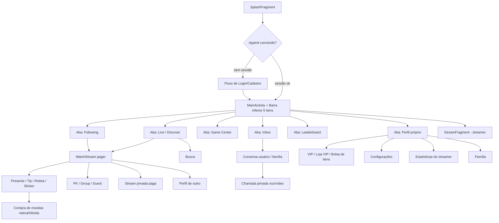
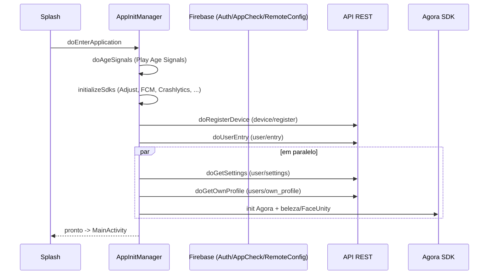
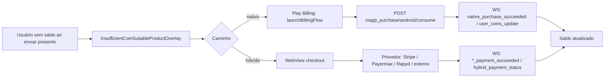
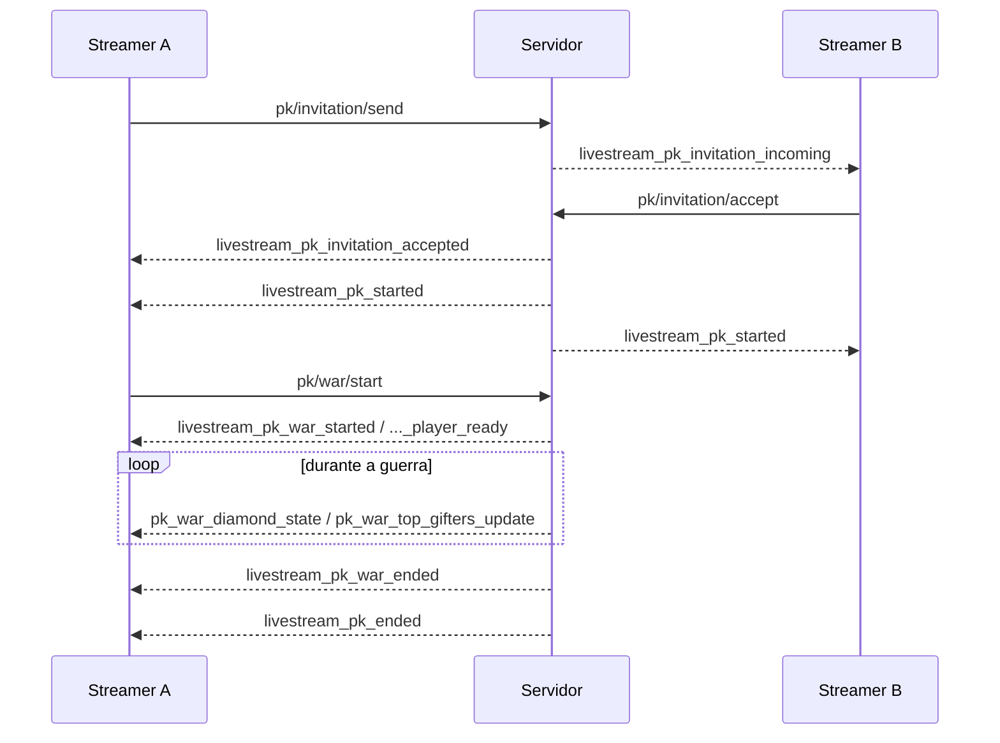
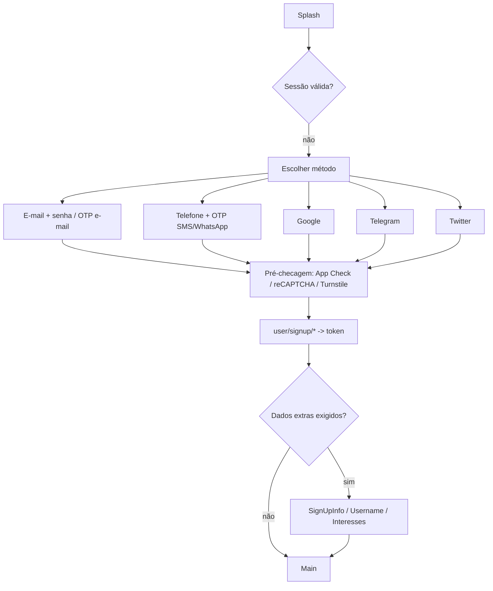
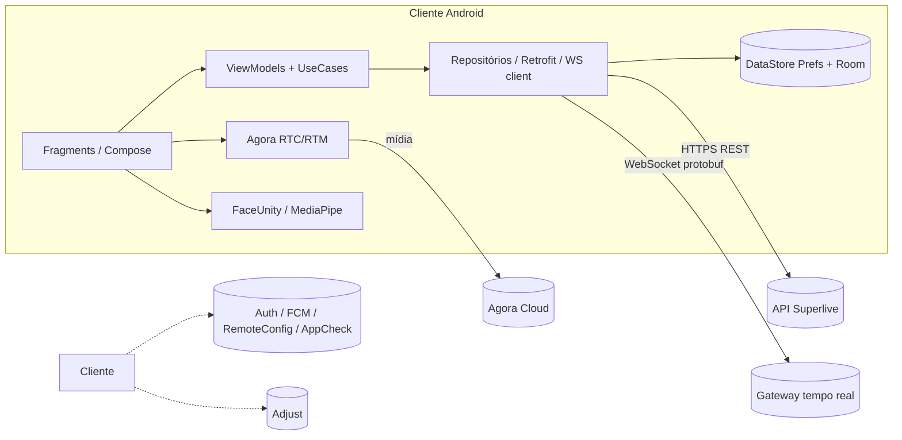
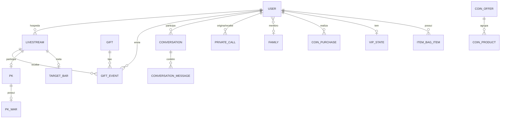
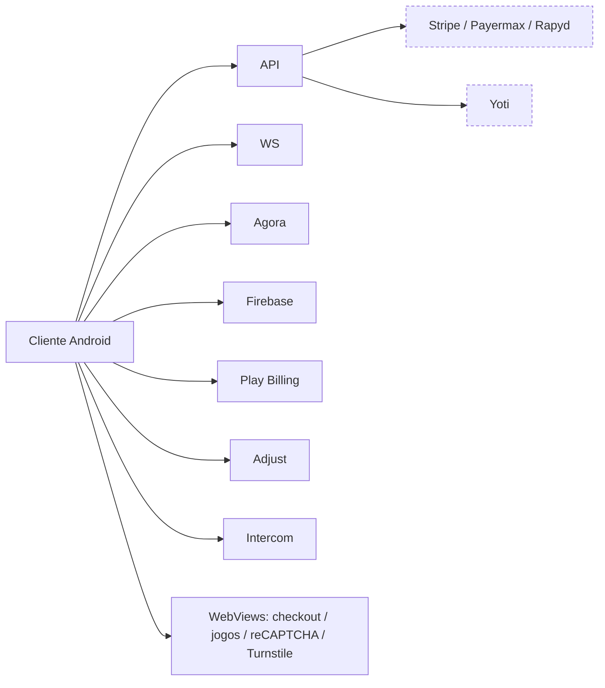

# Relatório Técnico e Funcional — Superlive (`com.superlive.liveapp`) v2.52.0

> **Natureza deste documento:** descoberta de produto para servir de referência a um produto independente. Nada aqui é código, layout ou identidade a ser copiado. Os `.proto` do app, os nomes de endpoint e os assets são propriedade da fabricante: use-os apenas para **entender o domínio** e desenhe contratos, nomes e visual próprios.
>
> **Limitação central (leia primeiro):** a análise foi **100% estática**. O ambiente tinha apenas o arquivo `superlive-2-52-0.xapk`; não havia app aberto, dispositivo/emulador, `adb`, Java, JADX nem apktool. **Nenhuma tela foi vista rodando, nenhuma interação foi executada e nenhuma requisição de rede foi capturada.** Tudo que descreve *comportamento* vem de estrutura, nomes, strings e contratos embutidos no pacote. Ver capítulo 17.

**Legenda de confiança**

| Rótulo | Significado |
|---|---|
| **[CONFIRMADO]** | Lido diretamente do artefato (manifesto, `.proto`, grafos de navegação, strings, lista de arquivos). Confirma *existência*, não *comportamento em execução*. |
| **[FORTE]** | Várias evidências técnicas consistentes entre si. |
| **[INFERÊNCIA]** | Hipótese baseada em nomes/estrutura. Não tratar como fato. |
| **[DESCONHECIDO]** | Não foi possível determinar. |

---

## 1. Resumo executivo

- **O que é [CONFIRMADO]:** app Android de **live streaming social monetizado**, em que espectadores gastam **moedas** (coins) em **presentes** (gifts) e criadores recebem **diamantes** (diamonds), convertidos em dinheiro por *cashout*. Inclui batalhas **PK** entre streamers, convidados/palestrantes, chamadas privadas pagas, mensagens diretas, feed de posts, "famílias" (grupos), agências, VIP por assinatura, loja VIP, jogos (Game Center) e rankings.
- **Arquitetura [FORTE]:** cliente Android nativo (Kotlin, **um único `MainActivity`** + Navigation Component com **24 grafos / 257 destinos únicos**), **API REST** (host base embutido) + **WebSocket com mensagens Protobuf** para eventos em tempo real, **Agora RTC** para áudio/vídeo, **Firebase** (Auth, FCM, Remote Config, Firestore, Crashlytics, App Check) e **Adjust** para atribuição.
- **Descoberta mais valiosa:** o APK embarca **35 arquivos `.proto`** (18 na raiz + 17 em `websocket/`, ≈136 KB) que descrevem com precisão o modelo de dados em tempo real: **179 tipos de evento servidor→cliente** e 6 ações cliente→servidor. Isso dá um mapa muito mais fiel do domínio do que se obteria só olhando telas.
- **Escala funcional:** ≈**333 caminhos REST** distintos identificados (contagem heurística), cobrindo autenticação, live, PK, chamadas, conversas, família, feed, loja, assinatura, estatísticas e suporte.
- **Principal lacuna:** comportamento real (regras de preço, fórmulas de conversão moeda→diamante→dinheiro, estados de cada tela, permissões por perfil) **não é observável estaticamente**. Exige execução em dispositivo/emulador com tráfego capturado (cap. 17).

---

## 2. Visão geral do produto

| Item | Valor | Confiança |
|---|---|---|
| Nome do app | Superlive | CONFIRMADO |
| Pacote | `com.superlive.liveapp` | CONFIRMADO |
| Versão | `2.52.0` (versionCode 721) | CONFIRMADO |
| minSdk / targetSdk / compileSdk | 32 / 36 / 37 (Android 12L+) | CONFIRMADO |
| Orientação | retrato fixo (`screenOrientation=1`); suporta Picture-in-Picture | CONFIRMADO |
| Distribuição | Google Play (splits `base__abi`, `base__density`); stamp `STAMP_TYPE_DISTRIBUTION_APK` | CONFIRMADO |
| Idiomas nos splits | árabe, espanhol, português (+ base, provavelmente inglês) | CONFIRMADO (splits) |
| Tamanho | base 74 MB; arm64 83 MB (SDK de vídeo/beleza) | CONFIRMADO |
| Restrição de idade | 18+ (múltiplas strings; verificação por face/ID; Play Age Signals) | CONFIRMADO |

**Problema que resolve [INFERÊNCIA com base forte em strings]:** conectar criadores a audiência pagante em tempo real, com várias camadas de monetização (presentes, assinatura de criador, chamadas privadas pagas, transmissão "premium"/privada paga por minuto, jogos) e mecanismos de retenção (VIP, níveis/XP, rankings, famílias).

**Perfis de usuário [FORTE]:** espectador; streamer; *guest*/*speaker* (convidado em stream); moderador (`modded`); gerente de agência/`manager`; líder/membro de família; revendedor de moedas (`CoinResellerAccount`); equipe de suporte (conversa com `assigned_to`, tickets).

---

## 3. Inventário de telas

**Totais [CONFIRMADO]:** 24 grafos de navegação · 110 fragments únicos · 147 diálogos/bottom-sheets únicos · 213 layouts XML · 1 Activity.

> **Aviso:** fragments/diálogos foram extraídos dos grafos de navegação binários. Nomes de classe são dados reais; **finalidade** é deduzida do nome e de strings (INFERÊNCIA salvo indicação). Componentes internos, estados e comportamento por tela **não foram observados** — por isso o capítulo 5 documenta o que é verificável por tela em vez de inventar detalhes.

### 3.1 Estrutura de navegação raiz
- `MainActivity` (única, `launchMode=singleTask`, exported) hospeda `main_navigation_graph` e grafos aninhados.
- **Barra inferior com 6 itens [CONFIRMADO: 6 itens em `bottom_nav_menu.xml`]**. Há 6 grafos de aba: *live/discover*, *followings*, *game center*, *inbox*, *leaderboard*, *self profile*. A correspondência item↔aba é **[INFERÊNCIA]** (ids sequenciais e nomes de grafos).

### 3.2 Inventário por módulo (classe → finalidade deduzida)

**A. Entrada, cadastro e login** (`splash_navigation_graph`, `sign_up_*`, `forgot_password_graph`, `linked_accounts_graph`, `profile_verification_graph`)

| Tela | Finalidade deduzida |
|---|---|
| `splash.SplashFragment` | Inicialização (ver §7.1) |
| `signup.newflow.SignUpFlowFragment` | Fluxo novo de cadastro |
| `signup.information.SignUpInfoFragment` | Coleta de dados (idade/gênero/nome) |
| `signup.signupoverlay.SignUpOverlayDialogFragment` | Login/cadastro sob demanda (usuário convidado) |
| `mailsignuplogin.newflow.ContinueWithEmailPageFragment` / `ContinueWithEmailFragment` | Entrar com e-mail |
| `mailsignuplogin.forgotpassword.*` (3 telas) | Esqueci a senha → código → nova senha |
| `phoneverification.loginphone.LoginPhoneFragment` / `loginphoneverification.*` | Login por telefone + OTP |
| `selectcountrycode.SelectCountryCodeBottomSheet` | Código do país |
| `linkedaccounts.LinkedAccountsFragment`, `mailsignuplogin.linkmail.MailConnectFragment` | Contas vinculadas |
| `mailsignuplogin.profileverification.*` (3 telas) | Verificar/atualizar e-mail |
| `usernamecreate.UsernameCreateFragment` | Criar username |
| `signup.initialfreecoin.InitialFreeCoinOverlayFragment` | Moedas grátis iniciais |
| `connectphonereward.ConnectPhoneNumberRewardDialog` | Recompensa por vincular telefone |
| `interest.ChooseInterestAreaDialogFragment` | Escolha de interesses |
| `ageverification.*`, `agerestriction.AgeRestrictionFragment`, `stream.ageestimation.*`, `vpn.VpnDetectedFragment` | Barreiras de idade/VPN |

**B. Descoberta e Home** (`navigation_live_graph`, `navigation_followings_graph`)

| Tela | Finalidade |
|---|---|
| `discover.pager.DiscoverPagerFragment` | Abas de descoberta (ver sub-seções abaixo) |
| `discover.countryselection.DiscoverCountrySelectionFragment` | Filtro por país |
| `followingtab.FollowingTabContainerFragment` | Streams de quem sigo |
| `search.SearchFragment` | Busca de usuários + histórico |
| `notification.NotificationFragment` | Notificações |
| `banner.PromotionBannerOverlayFragment` | Banners promocionais |

Sub-seções de descoberta **[CONFIRMADO, enum `DiscoverCtrSubSection`]**: POPULAR, COUNTRY, PK, NEW, MGS, VIDEO_CALL, SOCIAL, FOLLOWING_STREAM, SUGGESTED_STREAM; seções DISCOVER e FOLLOWING.

**C. Transmitir (streamer)** (`stream_fragment_graph`)

| Tela | Finalidade |
|---|---|
| `stream.StreamFragment` | Tela do streamer ao vivo |
| `stream.menudialog.StreamMenuDialogFragment`, `StreamPkSettingMenuDialogFragment` | Menus de controle |
| `livestreamoverlays.end.EndLivestreamBottomSheet`, `exit.ExitStreamDialogFragment` | Encerrar |
| `streamviewers.host.{single,pk,group}.*` | Lista de espectadores por modo |
| `livestreamoverlays.guestaccept.GuestAcceptOverlayFragment` | Aceitar convidado |
| `livestreamoverlays.inviteprivate.InviteToPremiumStreamFragment` | Convidar para stream premium |
| `livestreamoverlays.pk.{invite,pkinvitesent,receivedpkrequest,connecting}.*` | Convites e conexão PK |
| `groupstream.{invite,waitlist}.*` | Stream em grupo |
| `stream.verification.StartVerificationFragment`, `stream.faceverificationpending.*`, `stream.dialogs.welcome.WelcomeBonusDialog`, `stream.dialogs.ContinueStreamDialog` | Verificação e continuidade |
| `faceunity.FaceUnityBottomSheet` | Filtros de beleza/maquiagem |
| `statistics.{performance,earnings,streamduration,viewers,followers,payoutchart}.*` | 6 telas de estatísticas |

**D. Assistir (espectador)** (`watch_stream_graph`)

| Tela | Finalidade |
|---|---|
| `watchstream.pager.WatchStreamPagerFragment` | Deslizar entre streams |
| `watchstream.WatchStreamFragment`, `pip.NewWatchStreamDestinationFragment` | Player; modo PiP |
| `gift.stream.StreamGiftBottomSheet`, `batchgift.BatchGiftWarningDialog` | Enviar presente / em lote |
| `gift.stream.{hide,information}superannouncement.*`, `livestreamoverlays.gift.timeout.SuperGiftTimeoutDialogFragment` | Super Gift (anúncio global) |
| `stickergift.send.StickerGiftSendDialogFragment`, `spinningwheel.giftrequest.*` | Sticker-gift e roleta |
| `watchstream.tipmenu.{StreamTipsDialog,tipsendconfirmation.*}` | Menu de gorjetas |
| `livestreamoverlays.messaging.MessagingOverlayFragment` | Chat sobreposto |
| `watchstream.messagedialog.TranslateMessageDialog` | Traduzir mensagem |
| `watchstream.followdialog.LiveStreamFollowStreamerOverlay` | Seguir |
| `livestreamoverlays.guestrequest.GuestRequestOverlayFragment`, `groupstream.join.*` | Pedir para entrar no palco |
| `livestreamoverlays.report.*` (3), `watchstream.blockedstreamerfinishedoverlay.*` | Denúncia/bloqueio |
| `streamviewers.watcher.{single,pk,group}.*`, `topgiftsenders.*` | Espectadores e top gifters |
| `watchstream.switchprivatestream*` | Virar stream privada paga |
| `livestreamoverlays.game.LivestreamGameCenterOverlayFragment` | Jogos dentro da live |

**E. Chamadas privadas** (`main_navigation_graph`)
`privatecall.preview.{video,voice}.*`, `privatecall.ongoing.{video,voice}.*`, `privatecall.connecting.*`, `privatecall.ended.*`, `privatecall.settings.*`, `privatecall.report.*`, `privatecall.hamburgermenu.*`, `privatecall.tutorial.*`, `incomingpaidprivatecall.*` (2), `paidprivatecallinfo.*`, `gift.privatecall.*`, `gift.paidprivatecall.*`, `freecall.{call,info}.*`, `fakeprivatecall.FakePrivateCallPreviewFragment`, `dialogs.privatecallmute.*`.

**F. Mensagens (Inbox)** (`navigation_inbox_graph`, `user_conversation*`, `family_conversation*`, `messaging_overlay_graph`)
`inbox.messages.InboxFragment`, `conversation.user.UserConversationFragment`, `conversation.useroverlay.*`, `conversation.family.*`, `conversation.familyoverlay.*`, `livestreamoverlays.messaging.inbox.InboxOverlayFragment`, `gallery.sendmedia.SendMediaOverlayFragment`, `inbox.medias.PremiumAlbumMediasFragment`, `inbox.multiplemediapreview.*`, `welcomemessage.*` (2), `sendautomessage.SendAutoMessageFragment`, `conversation.report.*`, `conversation.user.UserBlockedDialog`, `gift.conversation.*` (2). Mídia: `generic.{mediapreview,videoplayer,mediaviewer}.*`, `imagecrop.ImageCropFragment`.

**G. Perfil próprio** (`self_profile_graph`)
`selfprofile.SelfProfileFragment`, `myprofile.MyProfileFragment`, `level.UserLevelFragment`, `profileviewers.ProfileViewersFragment`, `vip.uniqueusername.UniqueUserNameSettingsFragment`, `editprofile.*` (2), `feed.sharepost.SharePostFragment`, `subscription.center.SubscriptionCenterFragment`, `subscription.changeprice.*`.

**H. Perfil de outros e Feed**
`otherprofile.OtherProfileFragment`, `otherprofile.subscription.*` (2), `userfollowers.*`, `userfollowings.*`, `feed.detail.PostDetailFragment`, `feed.otherprofilefeed.OtherPostDetailFragment`, `feed.detail.like.FeedPostLikersFragment`, `feed.comment.FeedCommentsBottomSheetFragment`, `feed.report.*`, `feed.moreoptionsdialog.*`, `feed.deleteconfirmation.*`, `feed.confirmationdialog.*`, `feed.dialogs.*` (5 diálogos de falha/cancelamento de upload).

**I. Monetização: moedas, VIP, loja, assinaturas**
`purchase.{NativePurchaseFragment,NativePurchaseBottomSheet}`, `purchase.hybrid.HybridPurchaseDialog` (checkout via web), `multipaymentoffer.*` (2), `firstpurchase.FirstPurchaseDiscountFragment`, `giftbundle.{GiftBundleFragment,congrats.*}`, `coinreseller.CoinResellerDialog`, `refund.RefundDialog`, `vip.{vipprivileges,vipcoinpurchase,viprewards,howtocalculate,advantagedetail,viprenewreminder}.*`, `vipsubscription.{resubscription,SpecialVipSubscriptionOfferFragment,congrats,countryselection}.*`, `vipaward.VIPAwardDialogFragment`, `vipstore.{store,profilead,search.user,search.banfreeze,store.entryeffectpreview}.*`, `itembag.{remainingitems,expireditems,userselection}.*` (Bolsa de itens), `subscription.{confirmation,subscriptionwebview}.*`, `settings.subscriptionplan.*` (2), `premiumpreviewboost.*`.

**J. Comunidade**
`family.{profile,leaderboard,edit,invitation,creation,management,profile.transfer}.*` (7), `leaderboard.{LeaderboardFragment,countryselection.*}`, `topgiftsenders.TopGiftSendersFragment`, `gamecenter.{GameCenterFragment,hybridgame.HybridGameFragment,hybridgame.HybridGameExitDialog}`, `groupstream.invitations.GroupStreamInvitationReceivedFragment`.

**K. Configurações e suporte** (`settings_graph`)
`settings.setting.SettingsFragment`, `settings.account.AccountSettingsFragment`, `settings.blockedusers.*` (2), `moderation.ModeratorsFragment`, `settings.nsfw.NsfwSettingsFragment`, `settings.darklightviewsettings.*`, `settings.aboutus.AboutUsFragment`, `customersupport.{createticket,ratesupport}.*`, `ratingdialog.*` (3), `dialogs.{ExitDialog,CheckSessionDialog,GenericLoginRequiredDialog,PermissionNeverAskDialog,PermissionSettingsDialog}`, `custom.CustomWebView`, `hybrid.webview.HybridWebViewFragment`, `hybrid.recaptcha.ReCaptchaWebViewFragment`, `settings.subscriptionplan.survey.SubscriptionCancelSurveyFragment`, `badge.BadgeInfoOverlayFragment`, `level.GainedExperienceDialog`.

> Há **257 destinos únicos**; as tabelas acima agrupam a maioria. Destinos menores e repetidos entre grafos (ex.: diálogos de mídia reaproveitados em 4 grafos) aparecem uma vez. Para a lista literal completa, ver o arquivo de apoio gerado em `nav.txt` (scratchpad da sessão).

---

## 4. Mapa de navegação

**[INFERÊNCIA]** na ligação entre abas e telas; os **nós** (telas) são CONFIRMADOS.

---

## 5. Análise detalhada por tela

Não é possível entregar, de forma honesta, "componentes, estados e comportamento de cada ação" das 257 telas sem executá-las. Abaixo, **o que *é* verificável** para as telas centrais, ligando-as aos contratos reais. Os demais itens do roteiro (estados alternativos, comportamento responsivo, feedback) estão listados como lacuna no cap. 17.

### 5.1 `StreamFragment` (streamer) — **[FORTE]**
- **Dados de estado** (`LivestreamInfo`, 74 campos): `livestream_id`, `type`, `headline`, `viewer_count`, `diamond_count`, `coin_count`, `is_streamer`, `is_guest`, `is_modded`, `is_group_stream`, `is_speaker`, `guest_request_count`, `speaker_request_count`, até 3 objetos PK (`pk`, `pk_2`, `pk_3`), estados de convites PK/Team/TypeChange, `microphone_states`/`camera_states`/`app_background_states` por usuário, `text_box`, `gift_queue_state`, `sticker_info`, `private_stream_switch_settings`, `cashout_warning`, `premium_to_public_capability`.
- **Ações REST** associadas: `livestream/start`, `/start/agree_rules`, `/finish`, `/finish/agree_rules`, `/change_headline`, `/make_private`, `/make_public`, `/camera_on_off`, `/microphone_mute`, `/force_mute_microphone`, `/kick`, `/unkick`, `/mod`, `/unmod`, `/guest/*`, `/groupstream/*`, `/pk/*`, `/statistics`.
- **Verificações antes de transmitir [FORTE]:** aceite de regras (`start/agree_rules`), verificação de identidade (`livestream/check_id_verification`, Yoti, `StartVerificationFragment`), checagem de face/corpo durante a live (`FaceDetectionSettings`, `BodyDetectionSettings`: janelas de segundos de tolerância, contagem regressiva e limiar de visibilidade), conteúdo sensível (`SensitiveContentSettings`).

### 5.2 `WatchStreamFragment` (espectador) — **[FORTE]**
- Recebe eventos via WebSocket (cap. 11): chat, presentes, curtidas, viewers, PK, guests, entradas VIP, top gifters.
- Ações: enviar mensagem (`livestream/chat/send_text_message`), presente (`chat/send_gift`), curtir (`livestream/like`), traduzir (`chat/translate_message`), denunciar (`chat/report`, `livestream/report`), silenciar (`chat/mute`/`unmute`), pedir para entrar (`guest/send`, `groupstream/request/send`), compartilhar (`share_list`, `share_search`).
- **Modo "Whisper" (sussurro) [CONFIRMADO]:** campos `is_whisper_mode_active` em chat e presentes; string explica que "somente o streamer vê presentes e mensagens" de quem está em modo whisper. Campo `incognito_*` relacionado.

### 5.3 Chamadas privadas — **[FORTE]**
- `PrivateCallState{private_call_id, private_call_type, event_type, event_timestamp, sender_user, receiver_user, extra, option}` — máquina de estados dirigida por `event_type` (string; valores **[DESCONHECIDO]**).
- REST: `private_call/{start,accept,reject,cancel,dismiss,end,retrieve,send_gift,camera_on_off,app_on_background,report,prevent_notification,unprevent_notification,fake/action}`.
- Regra observável em texto: **chamada paga com presente recorrente por minuto** ("O presente selecionado será enviado automaticamente a cada minuto"), **janela de reembolso anti-golpe** ("saia em N segundos; taxa reembolsada"), `paidPrivateCallRefundDuration` nas settings.
- Existe `fake/action` e telas `FakePrivateCall*`/`private_call_state_fake` (evento 121): **[INFERÊNCIA]** recurso de chamada simulada/engajamento; finalidade e legitimidade **[DESCONHECIDO]**, merece escrutínio ético antes de qualquer equivalente.

### 5.4 Conversas — **[CONFIRMADO]** (contrato)
Tipos de mensagem (`ConversationMessageType`): TEXT, PHOTO, VIDEO, AUDIO, PRIVATE_CALL, GIFT, SYSTEM, PROFILE, LIVESTREAM, SUPPORT, PREMIUM_PHOTO e variantes (álbum premium, unlock, compartilhamento de perfil/live, oferta de assinatura de criador, notificação de agência). `ConversationStatus` traz `unseen_count`, `muted`, `silenced`, `is_pinned`, `conversation_tab(s)`, `diamonds_received`, e campos de suporte (`human_requested`, `is_resolved`, `assigned_to`, `priority`) — **a mesma estrutura serve a chat entre usuários, família e suporte ao cliente**.

### 5.5 Compra de moedas — **[FORTE]**
Dois caminhos coexistem: **nativo** (`NativePurchaseFragment/BottomSheet`, Google Play Billing 9.1.0) e **híbrido** (`HybridPurchaseDialog`, WebView para checkout web com múltiplos provedores). Ver cap. 12.

---

## 6. Catálogo de funcionalidades

IDs `F-xx`. "Telas" referem módulos do cap. 3. "Regras" são o que o artefato permite afirmar.

| ID | Funcionalidade | Entradas → saídas (observável) | Regras/Notas | Conf. |
|---|---|---|---|---|
| F-01 | Cadastro/login | e-mail+senha, telefone+OTP (SMS/WhatsApp), Google, Telegram, Twitter; `user/signup/*` | OTP expira em 60 s (string); `registerWithoutPassword`, `AuthPreCheck` (App Check, reCAPTCHA Enterprise, Turnstile) vêm das settings | CONFIRMADO |
| F-02 | Sessão de convidado | navegar sem logar | diálogos `GenericLoginRequiredDialog`/`SignUpOverlay` pedem login ao agir | FORTE |
| F-03 | Verificação de idade | face scan, ID (Yoti `yoti_age_estimation/step`), Play Age Signals, data de nascimento | "não pode alterar a idade depois"; 18+ | CONFIRMADO |
| F-04 | Descoberta de lives | abas Popular/País/PK/Novo/MGS/Vídeo/Social | filtro por país (`discover/countries`); CTR rastreado (`discover/ctr_track`) | CONFIRMADO |
| F-05 | Transmitir ao vivo | `livestream/start`; Agora; beleza | aceite de regras; checagem de face/corpo; tipo de stream (`type`) | FORTE |
| F-06 | Assistir/entrar | `livestream/enter`, `exit`; WS `enter_livestream` | stream pode ser **privada/premium paga** (`restrict_type`, moedas por minuto) | FORTE |
| F-07 | Chat ao vivo | texto, @tag, tradução, destaque, whisper | moderadores podem silenciar/expulsar; expulsão **reembolsa** moedas de entrada (string) | CONFIRMADO |
| F-08 | Presentes | `chat/send_gift`; lote (`gift_batch_size`); combo (`GiftComboDetail`); Lucky Gift; Super Gift; sticker-gift; roleta | Lucky Gift: "chance de ganhar 100x" (string); Super Gift: anúncio em **todas** as lives | CONFIRMADO |
| F-09 | Gorjetas/menu de tip | `get_tip_gifts`, `update_tip_gifts`, `PrivateStreamTipMenuUpdated` | menu configurável pelo streamer | FORTE |
| F-10 | PK (batalha) | convite, aceite, war, times, mudança de tipo; até 4 participantes ("4PK") | pontuação por diamantes/moedas; duração configurável (`PkDuration.availableValues`) | CONFIRMADO |
| F-11 | Convidados e palco em grupo | `guest/*`, `groupstream/*`; limite de speakers (`group_stream_speaker_limit`) | convite, pedido, waitlist | CONFIRMADO |
| F-12 | Stream privada paga ("premium") | `make_private`, `private_livestream_request/*`, `PrivateSwitch*` | cobrança por minuto; reembolso nos primeiros ~8 s (string anti-golpe); conversão premium→pública | CONFIRMADO |
| F-13 | Chamadas privadas voz/vídeo | ver §5.3 | cobrança por minuto via presente periódico | FORTE |
| F-14 | Mensagens diretas | ver §5.4; álbum premium pago; envio em massa ("send album to all") | custo de iniciar conversa (`ConversationStartCharge`); limite de pins (`messagePinLimit`) | CONFIRMADO |
| F-15 | Mensagem de boas-vindas / automática | `welcome_message/*`, `auto_message/*` (inclui estado de *chatbot*) | texto automático "no seu estilo" (string) | CONFIRMADO |
| F-16 | Feed de posts | `feed/*`: criar, comentar, curtir, denunciar, upload com URL pré-assinada | assinatura de criador pode gatear acesso (`creator_subscription/feed_web_access_url`) | CONFIRMADO |
| F-17 | Seguir/seguidores/bloqueio | `user/follow`, `unfollow`, `block`, `blocked` | seguidores/seguindo podem ser ocultados (`set_follower_and_following_hidden`) | CONFIRMADO |
| F-18 | Moedas (compra) | ofertas `CoinOffer`/`CoinProduct`; tags; promoções; primeira compra; multi-pagamento | provedores: Google Play, Stripe, Payermax, Rapyd, "external", híbrido | CONFIRMADO |
| F-19 | Diamantes e saque | diamantes recebidos; `cashOutUrl`, `earningsUrl`; "precisa ganhar X para saque de US$Y" (string) | conversão e mínimo exatos **[DESCONHECIDO]** | FORTE |
| F-20 | VIP (assinatura) | níveis (`vip`, `vip_state`), bronze→milionário; assinatura Play (`NativeSubscriptionPackage`) com `coinAmount` e `hasTrial` | benefícios: ocultar status/online/localização/diamantes, whisper, entrada com efeito, "intocável" (não pode ser silenciado/expulso), username único | CONFIRMADO |
| F-21 | Loja VIP | `user/vip_store/*`: efeitos de entrada, anúncio de perfil na 1ª página, remover "ban/freeze" | itens vão para a **Bolsa de itens** (`item_bag/*`) | CONFIRMADO |
| F-22 | Assinatura de criador | `creator_subscription/*`, `subscription/*` | preço configurável, desconto no 1º mês, cancelamento com pesquisa | CONFIRMADO |
| F-23 | Níveis/XP | `LevelingProgress`, `GeneralGainedExp`, `LevelUpProgression` | `GainedExperienceDialog`; fórmula **[DESCONHECIDO]** | CONFIRMADO |
| F-24 | Rankings | leaderboard por país; top gifters/streamers; ranks (`gifter_rank`, `streamer_rank`, `streamer_coin_rank`) | opção anônimo no ranking | CONFIRMADO |
| F-25 | Família | criar, convidar, gerentes, transferir, silenciar, expulsar, ranking, chat de grupo com mensagem fixada | só "líder" pode postar quando configurado (string) | CONFIRMADO |
| F-26 | Agência | `canCreateAgencyGroup`, `agencyUrl`, `commissionPercentage`, `user/agency/remove_manager` | agência gera "diamantes extras"; ao remover gerente não entra em nova agência (string) | FORTE |
| F-27 | Revendedor de moedas | `CoinResellerAccount`, `coinResellerUrl`, `sendCoinUrl` | detalhes **[DESCONHECIDO]** | FORTE |
| F-28 | Game Center | `game/*`, jogos HTML (`HybridGameFragment`), Evoplay; apostas com moedas **ou** diamantes | eventos `GameCenterGame{Init,Bet,Win,Refund}` | CONFIRMADO |
| F-29 | Estatísticas do streamer | `user_statistic/get_{earning,follower,payout_chart,performance,stream_duration,viewer}_statistic` | 6 telas | CONFIRMADO |
| F-30 | Convite/indicação | `user/referral`, `get_invite_list` | "até X% de comissão" sobre compras/diamantes dos indicados (string) | CONFIRMADO |
| F-31 | Suporte | tickets, sessões, avaliação de atendimento (`support/*`, `conversation/*ticket*`), Intercom | conversas de suporte compartilham modelo de mensagem | CONFIRMADO |
| F-32 | Moderação/denúncias | report de live/chat/convidado/chamada/feed/usuário; motivos configuráveis (`report_reasons_settings.proto`) | | CONFIRMADO |
| F-33 | Notificações | FCM; `user/notifications`; status/uso de push registrados | canal único `notification_channel_general_key` | CONFIRMADO |
| F-34 | Configurações de privacidade | ocultar: localização, online, visitantes, moedas enviadas, diamantes recebidos; incognito em lives públicas | maioria exige VIP (strings) | CONFIRMADO |
| F-35 | Tema | claro/escuro/sistema | persistido em `Prefs` | CONFIRMADO |

---

## 7. Fluxos operacionais

### 7.1 Inicialização do app — **[FORTE]** (nomes reais em `AppInitManager`)

Ordem exata e paralelismo: **[INFERÊNCIA]** a partir de nomes (`agoraDeferred`, `backendDeferred`, `getSettingsResult`, `ownProfileResult`, `userEntryResult`).

### 7.2 Compra de moedas — **[INFERÊNCIA estruturada]**

Evidência de que o **servidor confirma por evento WebSocket** (e não só pela resposta HTTP): eventos 125–131 e 143–145 do `ServerMessage`.

### 7.3 Ciclo de uma PK — **[FORTE]** (eventos reais)

### 7.4 Stream privada paga — **[INFERÊNCIA]**
`make_private` → eventos `livestream_turned_private`/`private_livestream_request` → espectador envia pedido/aceita → cobrança por minuto → `livestream_private_coins_finished` (acabou saldo) / `livestream_private_refund` / `livestream_private_user_exit` → `make_public`/`premium_to_public_capability`.

### 7.5 Login — **[INFERÊNCIA estruturada]**

---

## 8. Regras de negócio (extraídas de strings, enums e campos)

**Evidência: strings de UI e contratos [CONFIRMADO que o texto existe]; que a regra é aplicada no servidor é [INFERÊNCIA].**

1. **Idade mínima 18** em todo o app; transmitir <18 proibido; idade não editável depois.
2. **Anti-golpe em stream/chamada paga:** sair em poucos segundos → taxa reembolsada; se o streamer aceita e encerra logo, reembolso.
3. **Expulsão = reembolso:** ao expulsar usuário que pagou entrada, as moedas voltam a ele.
4. **VIP "intocável":** não pode ser silenciado nem expulso — **exceto** quando entra em modo incógnito (streamer pode silenciar).
5. **Whisper Mode:** quem entra assim só é visto pelo streamer; não pode entrar em stream com a opção ativa sem desligar (diálogo oferece desligar e pedir para entrar).
6. **Super Gift:** anúncio em todas as lives; tem temporizador para o próximo e opção de ocultar anúncios.
7. **Lucky Gift:** retorno variável ("até 100×"); há anúncio de "alto retorno".
8. **Saque (cashout):** exige acumular mínimo em diamantes → valor em US$ (string "precisa ganhar X por US$Y"); aviso (`CashoutWarning`) quando ganhos podem diminuir.
9. **Moeda vs. diamante:** espectador gasta **coins**; streamer recebe **diamonds**; em jogos o usuário pode apostar com **qualquer um dos dois**.
10. **Bônus por tempo:** `bonus_duration`, `bonus_multiplier`, `bonus_diamond_count` na live/chamada (programa de bônus ao streamer).
11. **Username:** 3–20 caracteres; pode mudar, mas com `nextUsernameChangeAt` (prazo entre mudanças); nome de exibição 5–30 (string).
12. **Fixar mensagens:** limite `messagePinLimit`; fixar nova substitui a atual.
13. **Primeira compra / pacotes especiais:** `SpecialSalePackageType`: FIRST_PURCHASE, SUPER, MEGA, BIG, MULTI_PAYMENT.
14. **Moedas grátis:** iniciais (`InitialFreeCoin`), periódicas (`ClaimablePeriodicFreeCoins`, algumas exigem telefone), recompensa por vincular telefone (`phoneNumberConnectRewardCoin`), presente grátis com auto-follow.
15. **Premium → Pública:** streamer pode converter stream premium em pública, sujeito a `premium_to_public_capability`.

**Regras ocultas relevantes (não visíveis na UI de superfície):** `isEligibleForGiftBundle`, `finishedLivestreamControlPeriodOnFeed`, limites de compartilhamento (`livestreamShareLimit`), pontos de bufferização de likes (`likeApiSendingBufferTime`), qualidade de vídeo por modo/participantes (`AgoraVideoQualitySettings`). **Valores numéricos: [DESCONHECIDO]** (vêm do servidor).

---

## 9. Arquitetura técnica

| Camada | Evidência | Conf. |
|---|---|---|
| Linguagem/UI | Kotlin (kotlinx.serialization, coroutines, `DebugProbesKt`), Navigation Component, ViewBinding (213 layouts), **Jetpack Compose + Material3 parcial** | CONFIRMADO |
| Estrutura de código | pacotes `com.superlive.liveapp.{ui,managers,application,services,receivers}`, `com.superlive.domain.usecase.*`, módulo `module.websocket.protobuf` → **Clean Architecture** (UI / domain use cases / data) | FORTE |
| DI | Hilt (`androidx.hilt`, `dagger.hilt`) | FORTE |
| Rede REST | OkHttp + Retrofit (strings `retrofit2/`, `okhttp3`), Cronet presente (`org.chromium.net`) | FORTE |
| Tempo real | WebSocket com mensagens **Protobuf** (`ServerMessage`/`ClientMessage`); flag `isProtobufMessagesEnabled` nas settings sugere migração de JSON | CONFIRMADO |
| Mídia ao vivo | **Agora RTC** (`libagora-rtc-sdk.so`, 27 MB) + extensões: face detection, clear vision, video quality analyzer; canal RTM para sinalização (`agora_rtm_token`) | CONFIRMADO |
| Beleza/AR | **FaceUnity** (`libCNamaSDK.so`, `libfuai.so`, bundles `face_beautification`, `face_makeup`) + MediaPipe + ML Kit Selfie Segmentation | CONFIRMADO |
| Lib nativa própria/terceiro | `libxeno_native.so` (21 MB), `libsigner.so` — **finalidade [DESCONHECIDO]**; `libsigner` sugere assinatura de requisições **[INFERÊNCIA]** | — |
| Mídia de reprodução | Media3 (ExoPlayer); Lottie para animações (19 pastas em `assets/lottie`, com centenas de frames WebP: presentes, moedas, bordas VIP, vitórias) | CONFIRMADO |
| Imagens | Glide e Coil (ambos presentes) | CONFIRMADO |
| Persistência local | **DataStore (Preferences/Proto)** — `Prefs` proto; **Room** presente; token de acesso (`user_access_token`) guardado em `Prefs` | CONFIRMADO |
| Background | WorkManager | CONFIRMADO |
| Auth | Firebase Auth + Credentials/One-tap Google; Telegram OAuth; Twitter; App Check (Play Integrity); reCAPTCHA Enterprise; **Cloudflare Turnstile** | CONFIRMADO |
| Config remota | Firebase Remote Config **e** config própria (`remoteConfigBaseUrl`, `secondaryConfigDomain` com domínio de contingência) | CONFIRMADO |
| Telemetria | Crashlytics, Firebase Analytics, **Adjust**; evento `client_log/client_failure_log`; `client_analytics.proto` | CONFIRMADO |
| Suporte | Intercom (config em `Prefs`/`Settings`) | CONFIRMADO |
| Pagamentos | Google Play Billing 9.1.0; WebViews para provedores web | CONFIRMADO |
| Perfil de build | Release (`debug-overrides` só para depuração), `allowBackup=false`, `usesCleartextTraffic=false` | CONFIRMADO |

**Backend: [DESCONHECIDO].** Não há evidência de linguagem, framework, banco de dados ou broker. Os `google/firestore/v1` no APK são tipos do SDK Firestore cliente; o app **declara Firestore como dependência**, mas **o uso funcional [DESCONHECIDO]**.

---

## 10. Modelo de dados

Somente o que está nos `.proto` (**[CONFIRMADO]**). Tipos: ids de usuário/live são `string` ou `int64` conforme o campo.

### 10.1 Entidades principais
| Entidade | Campos relevantes |
|---|---|
| **User / EmbeddedUser / OwnProfileUser** | `user_id`, `shared_id`, `name`, `username`, `bio`, `gender`, `birthday`, `country`, `profile_images[]`, `vip`, `vip_state`, `level`, `follower_count`, `following_count`, `coins`, `diamonds`, `gifter_rank`, `streamer_rank`, `has_verified_badge`, `manager_id`, `family`, flags de privacidade (`*_hidden`), `special_username`, `agora_data` |
| **Livestream (LivestreamInfo)** | `livestream_id`, `type`, `headline`, `viewer_count`, `diamond_count`, `coin_count`, `restrict_type`, `agora_*`, `pk*`, `guests[]`, `speakers[]`, `text_box`, `sticker_info`, `gift_queue_state` |
| **Gift / ClientGift** | `gift_id`, `name`, `cost` (coins), `diamond`, `type`, `category`, `sub_category`, `placements[]`, `vip_state_required`, mídia (`image`, `animation_url`, `video_url`, `lottie_images_base_url`), `animation_duration`, `gift_name_dict` (i18n) |
| **Pk / PkWar / PkInvitation / PkTeamInvitation** | `id`, `type`, `livestream`, `user`, `war{state, *_diamonds, scheduled_finish_time}`, `scoreboard`, `diamond_bet_amount` |
| **PrivateCallState / Earnings** | ver §5.3 |
| **ConversationStatus / ConversationMessage** | ver §5.4 |
| **CoinOffer / CoinProduct / PaymentType** | `sku`, `amount`, `tag`, `payment_types[]{provider, code, price}`, `saved_cards[]`, `preferred_payment_method` |
| **VipState / VipStoreProduct / NativeSubscriptionPackage** | `calculatedDays`, `vipRemainingDay`, `upperLimit`, `currentState`, `productId`, `basePlanId`, `coinAmount`, `hasTrial` |
| **TargetBar** | meta de ganhos da live: `title`, `start_amount`, `target_amount`, `earned_amount`, `end_time` |
| **SpinningWheel**, **Sticker** | roleta com opções e presente; sticker com meta |
| **Family / FamilySettings** | `family`, gerentes, ranking (campos detalhados **[DESCONHECIDO]**: `.proto` de família só tem eventos de pin) |
| **Settings / Prefs** | configuração do servidor e preferências locais (cap. 9) |

### 10.2 ER (somente o observado)

Cardinalidades e chaves são **[INFERÊNCIA]**; as entidades são **[CONFIRMADAS]**. **Não** inferi tabelas SQL: o formato de armazenamento no servidor é **[DESCONHECIDO]**.

---

## 11. APIs e comunicação

### 11.1 REST
- **Hosts embutidos [CONFIRMADO]:** `api.sprlv-api.com` (aparente produção) e `api.liveapp-dev.com` (aparente dev) — qual deles o build usa **[DESCONHECIDO]** sem executar. Base completa e prefixos de versão **[DESCONHECIDO]**; há um caminho `/v2/purchase` isolado.
- **Autenticação [INFERÊNCIA]:** token em `Prefs.user_access_token`; mecanismo exato (header, assinatura via `libsigner`) **[DESCONHECIDO]**.
- **≈333 caminhos** (heurística). Famílias (contagem aproximada):

| Prefixo | Exemplos |
|---|---|
| `user/signup/*` (≈22, dentro de `user/*`) | `email_signin`, `phone`, `otp`, `google`, `telegram`, `twitter`, `renew_password` |
| `user/*` (≈87 no total, incl. signup) | `entry`, `settings`, `follow`, `block`, `set_*` (privacidade), `vip_store/*`, `notifications`, `purchase_history` |
| `users/*` | `own_profile`, `profile`, `update`, `search`, `image/upload`, `verify/update` |
| `livestream/*` (≈78) | `start`, `enter`, `finish`, `pk/*`, `guest/*`, `groupstream/*`, `chat/*`, `private_livestream_request/*` |
| `private_call/*` (14) | `start`, `accept`, `end`, `send_gift`, `report` |
| `conversation/*` (≈38) | `messages`, `send_*_message`, `premium_media_album/*`, `read`, `mute`, `pin` |
| `family/*` (≈21), `feed/*` (≈12), `game/*` (6), `item_bag/*` (6), `creator_subscription/*` (11), `subscription/*` (6), `inapp_purchase/*` (3), `user_statistic/*` (6), `welcome_message/*`, `auto_message/*`, `spinning_wheel/*`, `sticker/*`, `target_bar/*`, `device/*`, `discover/*`, `search_history/*`, `support/*`, `banner/*`, `client_log/*` | |

**Métodos HTTP, parâmetros e formato de resposta: [DESCONHECIDO]** (anotações Retrofit não foram decodificadas; sem tráfego capturado).

### 11.2 WebSocket (contrato completo — **[CONFIRMADO]**)
- **Cliente → servidor** (`ClientMessage{id, oneof action}`): `auth{token}`, `heartbeat{state}`, `enter_livestream{livestream_id}`, `leave_livestream`, `subscribe_heartbeat{user_id}` (presença online de outro usuário), `unsubscribe_heartbeat`.
- **Servidor → cliente** (`ServerMessage{id, oneof payload}`): **179 tipos**. Respostas às ações vêm como `ClientActionAck{success, message}` (tags 171–177).
- Grupos de eventos:

| Grupo | Exemplos |
|---|---|
| Chat/presente/live | `livestream_message_sent`, `livestream_gift_sent`, `viewers_update`, `like`, `top_gifters_update`, `vip_enter`, `new_follower`, `headline_changed`, `ended`, `kicked`, `turned_private/public` |
| PK | `pk_started`, `4pk_join/left`, `pk_war_*`, convites e mudança de tipo, `crazy_pk_war_*` |
| Guest/Group | `guest_join/leave/request_*`, `groupstream_speaker_*` |
| Chamadas | `private_call_state`, `*_camera_update`, `*_message_received`, `paid_private_call_gift_update` |
| Conversa | `conversation_message_received`, `_seen`, `_removed`, `_messages_updated` |
| Moderação | `livestream_muted/modded/forced_private/private_refund` |
| Economia | `user_coins_update`, `coin_info_updated`, `*_payment_succeeded`, `vip_award`, `lucky_gift_payback`, `super_gift_announcement`, ofertas/descontos |
| Jogos | `evoplay_game_*`, `game_center_*` |
| Sistema | `general_settings_update`, `general_unseen_*`, `invalid_auth`, `duplicate_connection_close`, `agora_log_upload`, `yoti_verification_result` |

Observação de projeto: o **servidor empurra até estado de UI** (ex.: `show_gift_bundles`, `crazy_sale_overlay`, `insufficient_coin_suitable_product_overlay`) — o cliente é "burro" para promoções.

### 11.3 Tratamento de erros [FORTE]
`InvalidAuth`, `DuplicateConnectionClose` (uma conexão por conta), `ClientActionAck.success/message`, diálogos de falha de upload (5 variantes), `CheckSessionDialog`, `client_failure_log`.

---

## 12. Integrações

| Serviço | Finalidade | Quando | Dados (observável) | Se indisponível | Conf. |
|---|---|---|---|---|---|
| **Agora** (RTC+RTM) | áudio/vídeo ao vivo e sinalização | ao entrar/transmitir/chamar | `agora_id`, `channel_id`, tokens RTC/RTM vindos do servidor | sem mídia **[INFERÊNCIA]**; evento `agora_log_upload` | CONFIRMADO |
| **Firebase** Auth/AppCheck/FCM/RemoteConfig/Crashlytics/Analytics | identidade, anti-abuso, push, flags, crash | inicialização/login | tokens FCM (`device/register_fcm_token`) | **[DESCONHECIDO]** | CONFIRMADO |
| **Google Play Billing 9.1** | compra de moedas/assinatura VIP | checkout nativo | SKUs de `Settings.allInAppSkuIds/allSubSkuIds`; `obfuscatedAccountId` | cai para checkout híbrido **[INFERÊNCIA]** | CONFIRMADO |
| **Provedores web** (Stripe, Payermax, Rapyd, "external") | pagamento alternativo, cartões salvos, multi-método | checkout híbrido | `PaymentType`, tokens salvos | **[DESCONHECIDO]** | CONFIRMADO (nomes em eventos) |
| **Adjust** | atribuição/marketing | boot e eventos | IDs de dispositivo/anúncio | n/a | CONFIRMADO |
| **Intercom** | suporte | tela de ajuda | hash de usuário, segredos cifrados | **[DESCONHECIDO]** | CONFIRMADO |
| **Yoti** | verificação de idade/identidade | antes de transmitir/saque | evento `yoti_verification_result` | **[DESCONHECIDO]** | CONFIRMADO |
| **Telegram / Google / Twitter** | login e vínculo de conta | login/ligar conta | OAuth | **[DESCONHECIDO]** | CONFIRMADO |
| **Cloudflare Turnstile / reCAPTCHA Enterprise** | anti-bot no login | pré-checagem | token captcha | login bloqueado **[INFERÊNCIA]** | CONFIRMADO |
| **Evoplay** + jogos HTML | Game Center | abrir jogo | eventos init/bet/win/refund | **[DESCONHECIDO]** | CONFIRMADO |
| **Play Age Signals** | sinal de idade | boot | `doAgeSignals` | **[DESCONHECIDO]** | CONFIRMADO |

Linhas tracejadas = **[INFERÊNCIA]** (integração presumivelmente server-side, não vista no cliente).

---

## 13. Segurança e permissões (somente observável, sem tentativa de exploração)

**Permissões Android [CONFIRMADO]:** câmera, microfone, localização aproximada, notificações, mídia (imagens/vídeo/áudio), biometria, estado do telefone, Bluetooth, boot, billing, AD_ID/atribuição. Chama atenção `READ_PRIVILEGED_PHONE_STATE` (só concedida a apps do sistema; provavelmente inócua) — **[INFERÊNCIA]**.

**Controles observados**
- `usesCleartextTraffic=false`; `network_security_config` com `base-config` sem cleartext e uma `domain-config` que **permite** cleartext para um domínio (valor textual não decodificado → **[DESCONHECIDO]**). `debug-overrides` confia em certificados de usuário (típico de build de debug mantido no release — vale checar).
- `allowBackup=false`; `dataExtractionRules`.
- Componentes exportados: `MainActivity` (deep links `superlive://` e `https://app58723713-login.tg.dev/tglogin` com `autoVerify`), receptores/serviços padrão de Firebase/WorkManager/Profileinstaller.
- Anti-abuso de login: App Check (Play Integrity), reCAPTCHA Enterprise, Turnstile — controlados por flags do servidor (`AuthPreCheck`).
- Sessão: um WebSocket por conta (`duplicate_connection_close`), `invalid_auth`, token no cliente em `Prefs`.
- **Perfis/permissões no produto:** espectador / streamer / guest / speaker / moderador / líder de família / gerente de agência / revendedor — capacidade é decidida pelo **servidor** (flags `is_modded`, `can_create_*`, `vip_state`); regras exatas **[DESCONHECIDO]**.
- Proteções de conteúdo: face/corpo detection, conteúdo sensível, NSFW toggle, denúncia, bloqueio, verificação 18+.

**Não testado:** respostas a acesso não autorizado, expiração/renovação de sessão, rate limit, validações de servidor.

---

## 14. Análise UX/UI

**Fontes:** Inter (família completa), Red Hat Display, Avenir (heavy/medium/black), Google Sans, Roboto (números), "matchmaker" (display) — **[CONFIRMADO]**. Alto número de variações indica **mistura de identidades acumuladas** ao longo do tempo **[INFERÊNCIA]**.
**Cores:** 73 recursos de cor + 7 variantes v23; claro/escuro/sistema (`DarkLightViewSettings`) — paleta exata não extraída (**[DESCONHECIDO]**).
**Componentes/padrões [CONFIRMADO por estrutura]:**
- **Bottom sheets e diálogos dominam** (147 dos 257 destinos): fluxos secundários nunca saem do contexto da live — decisão central de UX.
- Overlays sobre a live (chat, gift, perfil, convites) → o usuário não "abandona" o vídeo.
- Deslizar entre streams (`WatchStreamPager`), PiP, retrato fixo.
- **Gamificação pesada:** níveis/XP, bordas e overlays VIP animados (Lottie), efeitos de entrada, ranks, badges, toasts de ganho.
- **Mensageria de monetização contextual:** overlays de compra aparecem quando falta saldo; ofertas empurradas por evento do servidor.
- **Tutoriais "uma vez"** controlados por flags em `Prefs` (≥15: gift, super gift, tip menu, 4PK, mídia, etc.).
- i18n: nomes de presentes vêm do servidor em dicionários por idioma.

**Acessibilidade/responsividade:** **[DESCONHECIDO]** (não observado). `supportsRtl=true` e split de árabe indicam suporte a RTL.

**Princípios úteis para um produto próprio (sem copiar visual):** manter o espectador no vídeo; empurrar economia/promo do servidor para mudar ofertas sem release; separar feedback de ganho (XP/ranks) em componentes reutilizáveis; flags de tutorial persistidas.

**Ressalva ética:** várias mecânicas (Lucky Gift de retorno variável, cobrança por minuto, chamadas "fake", reembolso condicionado a tempo) são de **alto risco regulatório e de dano ao usuário** (jogos de azar, proteção ao consumidor, minors). Avaliar com jurídico antes de reproduzir equivalentes.

---

## 15. Diagramas técnicos (resumo)
Já incluídos: mapa de navegação (§4), init (§7.1), compra (§7.2), PK (§7.3), login (§7.5), arquitetura (§9), ER (§10.2), integrações (§12). Hierarquia de módulos:

```mermaid
flowchart TD
  App[Superlive App] --> Acc[Conta & Identidade]
  App --> Live[Live Core]
  App --> Soc[Social]
  App --> Eco[Economia]
  App --> Com[Comunidade]
  App --> Ops[Operação & Segurança]
  Acc --> a1[Login/Cadastro] & a2[Idade/ID] & a3[Perfil/Privacidade]
  Live --> l1[Descoberta] & l2[Transmitir] & l3[Assistir] & l4[PK/Guest/Grupo] & l5[Privada paga] & l6[Chamadas]
  Soc --> s1[Inbox/Conversas] & s2[Feed] & s3[Seguir/Bloquear]
  Eco --> e1[Moedas] & e2[Presentes] & e3[Diamantes/Saque] & e4[VIP/Loja/Bolsa] & e5[Assinatura de criador] & e6[Jogos]
  Com --> c1[Família] & c2[Agência] & c3[Rankings] & c4[Revendedor]
  Ops --> o1[Moderação/Denúncia] & o2[Suporte] & o3[Estatísticas] & o4[Notificações]
```

---

## 16. Dependências entre funcionalidades

| Funcionalidade | Depende de |
|---|---|
| Enviar presente | Saldo de moedas (F-18) → Compra; `vip_state_required` do presente (F-20) |
| Transmitir | Idade 18+ (F-03), verificação de ID, aceite de regras, foto de perfil (`isProfilePhotoMissingForStream`) |
| Saque | Diamantes (F-08/F-10), verificação de ID, mínimo |
| PK / Guest | Estar transmitindo; convite e aceite; limite de speakers/participantes |
| Stream privada / chamada paga | Moedas; presentes periódicos; janelas de reembolso |
| Whisper / ocultar status / entrada com efeito | VIP (F-20) |
| Itens da Loja VIP | Bolsa de itens (`item_bag`) |
| Família / Agência | Contas elegíveis (`canCreateFamily`, `canCreateAgencyGroup`) |
| Banners/descontos/overlays | Estado empurrado pelo servidor via WS e `Settings` |
| Quase tudo | Sessão WS autenticada (`auth` com token) |

---

## 17. Limitações da investigação e lacunas

**O que faltou no ambiente (explícito):**
1. **Nenhum app em execução / nenhum dispositivo** — `adb` ausente (REA: `capability_unavailable`). Sem isso: nenhuma tela vista, nenhuma captura de rede.
2. REA/JADX e REA/apktool **não configurados** (`REA_JADX_MCP_JAR`, `REA_APKTOOL_COMMAND`); sem Java no sistema. Substituí por parsers Python próprios para: manifesto binário, grafos de navegação, `resources.arsc`, strings dos DEX.
3. **Sem decompilação do código (smali/Java)** — não foi possível ver lógica, validações, anotações Retrofit (métodos HTTP/parâmetros), constantes numéricas, nem o conteúdo de `libxeno_native`/`libsigner`.
4. Só o APK base foi examinado em detalhe; os splits de idioma/densidade/ABI foram apenas listados.
5. **Sem conta/credenciais** — fluxos autenticados e permissões por perfil não testados.

**Lista de lacunas e como investigá-las**

| # | Lacuna | Como investigar |
|---|---|---|
| 1 | Aparência, estados e comportamento reais de cada tela | Rodar em emulador/dispositivo; navegar com capturas de tela (ferramentas ADB/UI do REA); roteiro por grafo |
| 2 | Métodos HTTP, parâmetros, respostas, headers, base URL real, assinatura de requisição | Decompilar com JADX (interfaces Retrofit) **e** capturar tráfego legítimo da própria sessão em dispositivo de teste (proxy/Frida onde permitido) |
| 3 | Valores de `event_type` de chamadas, enums numéricos (`type`, `category`, `restrict_type`, `vip_state`) | Decompilar enums/mapeadores; observar eventos WS em runtime |
| 4 | Fórmulas moeda→diamante→US$, mínimos de saque, comissão de agência, XP/níveis | Telas de ganhos/FAQ in-app (`earningsUrl`, `cashOutUrl`); respostas reais de `user/settings`; documentação pública da empresa |
| 5 | Backend, banco, filas | Inalcançável pelo cliente; só inferível por cabeçalhos de resposta/comportamento; manter como **desconhecido** |
| 6 | Papel de `libxeno_native.so` e `libsigner.so` | Análise nativa (REA em ELF arm64) para strings/exports/xrefs; confirmar se é anti-tamper/assinatura |
| 7 | Uso real de Firestore | Buscar usos de `FirebaseFirestore` no código decompilado; observar tráfego `firestore.googleapis.com` |
| 8 | `domain-config` com cleartext permitido | Decodificar `network_security_config.xml` com apktool para ver o domínio |
| 9 | Conteúdo dos splits (strings pt/es/ar) e assets | Decodificar com apktool; comparar locales |
| 10 | Fluxos interrompidos/erros/validações de formulário | Testar em runtime com dados fictícios e conta de teste própria |
| 11 | Acessibilidade e responsividade | Auditoria em dispositivo (TalkBack, tamanhos de fonte, tablets) |
| 12 | Permissões por perfil (moderador, agência, família) | Contas de teste por perfil, **com autorização da empresa**, sem tentar contornar controles |

**Verificação de qualidade (cap. 13 do pedido):** há telas/fluxos **não exploradas**, funcionalidades **não testadas**, regras **não esclarecidas** e dependências possivelmente incompletas. **Esta análise NÃO deve ser considerada completa**; ela é uma base estática sólida (contratos, estrutura, endpoints, tecnologias) a ser complementada por análise dinâmica.

---

## 18. Glossário

| Termo | Significado |
|---|---|
| **Coin / Moeda** | Moeda comprada pelo usuário; gasta em presentes, streams privadas, chamadas, jogos |
| **Diamond / Diamante** | Crédito do streamer recebido por presentes; base do saque |
| **Gift / Presente** | Item animado enviado em live; custa moedas, rende diamantes |
| **Lucky Gift** | Presente com retorno variável ao remetente |
| **Super Gift** | Presente cujo envio é anunciado em todas as lives |
| **PK / Battle / War** | Disputa entre 2–4 streamers por diamantes recebidos |
| **Guest / Speaker** | Participante convidado ao palco de uma live (guest em live individual; speaker em live de grupo) |
| **Premium / Private stream** | Live paga por minuto, só para quem paga |
| **Whisper Mode** | Presença discreta; só o streamer vê gifts/mensagens do usuário |
| **Incognito** | Esconder identidade em lives públicas |
| **VIP** | Assinatura/status por níveis (bronze→milionário) com privilégios |
| **Item Bag** | Inventário de itens comprados/ganhos |
| **Family** | Grupo de usuários com líder, gerentes, ranking e chat |
| **Agency** | Organização que agrega streamers e gera comissão |
| **Cashout** | Conversão de diamantes em dinheiro |
| **Hybrid** | Telas servidas por WebView (compra, jogos) |
| **MGS** | Sub-seção de descoberta (significado exato **[DESCONHECIDO]**) |
| **Target Bar** | Barra de meta de ganhos numa live |
| **Agora RTC/RTM** | SDK de vídeo/áudio em tempo real e de mensagens/sinalização |

---

## 19. Conclusões técnicas

1. O produto é um **sistema de tempo real orientado a eventos**: poucas ações REST de "comando" e um único canal WebSocket protobuf que **propaga estado**; o cliente reflete eventos.
2. A **economia** (moedas → presentes → diamantes → saque) é o centro; boa parte da UI (promoções, ofertas, overlays) é **comandada pelo servidor**.
3. A superfície funcional é grande (≈333 endpoints, 179 eventos, 257 destinos); o app é essencialmente **uma plataforma** (live + social + loja + jogos + comunidade).
4. Decisões técnicas notáveis: **UI em overlays**, **Agora** em vez de WebRTC próprio, **FaceUnity** para beleza, **config remota com domínio de contingência**, **pré-checagem anti-bot** no login, migração para **protobuf** no WS.
5. Há **dívida/legado visível**: duas bibliotecas de imagem, múltiplas famílias tipográficas, mix View+Compose, ExoPlayer+Media3, dois fluxos de compra (nativo+híbrido).
6. A parte mais arriscada do domínio é **regulatória/ética** (menores, apostas, cobrança recorrente, anti-golpe), não técnica.

---

## 20. Recomendações para um produto independente

**Escopo (MVP sugerido):** (1) conta + verificação de idade, (2) live 1:N com chat e presentes simples, (3) saldo de moedas e compra via loja nativa, (4) painel de ganhos do criador, (5) moderação/denúncia. Só depois: PK, convidados, chamadas, VIP, família.

**Arquitetura**
- Separar **comando (REST/gRPC)** de **eventos (WebSocket/SSE)** com um **envelope versionado** e `oneof` de eventos — a ideia é boa; **desenhe seu próprio schema** e nomes.
- Mídia ao vivo: avaliar provedor gerenciado (Agora, LiveKit, outros) por custo/latência; **LiveKit** ou similares evitam lock-in em SDK proprietário.
- Servidor autoritativo para **economia** (saldos, conversões, reembolsos); o cliente nunca decide valores. Livro-razão (ledger) com idempotência por `event_id` para compras e presentes.
- Config e promoções via **flags/remote config**; evite lógica de preço no cliente.
- Telemetria desde o início (funil de compra, retenção de live).

**Produto/UX**
- Manter o usuário "dentro do vídeo" (sheets/overlays), mas com **sistema de design próprio** (uma família tipográfica, tokens, dark/light, RTL).
- Tutoriais únicos controlados por flags; gamificação opcional e **transparente** sobre regras.

**Segurança e conformidade (prioridade alta)**
- Idade e proteção de menores desde o MVP; moderação de conteúdo em tempo real; auditoria de ledger.
- **Evitar** (ou validar juridicamente) mecânicas de "retorno variável", cobrança recorrente por minuto sem consentimento claro e recursos de "chamada simulada".
- Conformidade LGPD/GDPR, PCI via provedor de pagamentos, termos de criador e política de saque.

**Antes de decidir arquitetura final:** execute os itens 1–4 da lista de lacunas (§17) para trocar INFERÊNCIAS por CONFIRMAÇÕES, **respeitando termos de uso e a lei** (análise de interoperabilidade/pesquisa; sem acessar dados de terceiros nem contornar controles).

---

### Anexo A — Evidências e reprodutibilidade
- Origem: `superlive-2-52-0.xapk` (97,4 MB) → `com.superlive.liveapp.apk` (74 MB) + `config.{ar,es,pt,xhdpi,xxhdpi,arm64_v8a}.apk`.
- Extraído para diretório isolado (scratchpad da sessão); nada foi instalado nem executado.
- Ferramentas próprias (Python, somente leitura): `axml.py` (manifesto/XML binário), `nav.py` (grafos), `dexstr.py` (strings dos 4 DEX = 123.811 strings únicas), `arsc.py` (3.444 strings de recursos).
- Principais arquivos-fonte de evidência dentro do APK: `AndroidManifest.xml`, `res/navigation/*.xml` (24), `websocket/*.proto` (17), `*.proto` da raiz (18), `resources.arsc`, `classes*.dex` (4), `lib/` (via split arm64).
